# Spesifikasi & Activity Diagram Rapi (100% Hitam Putih & Tanpa Garis Bertabrakan) - Sistem Informasi SIMBA
**Balai Pemasyarakatan (Bapas) Kelas I Banjarmasin**

> [!NOTE]
> Seluruh Activity Diagram telah dirancang lengkap dan terstruktur rapi untuk seluruh proses operasional SIMBA, termasuk **operasi Hapus Surat Masuk, Surat Keluar (Tambah, Detail, Hapus), dan Hapus Data Klien**.
> - **Format Visual**: Menggunakan gaya **Hitam Putih Murni (Black & White)** sesuai kaidah akademik UML tanpa warna warni.
> - **Jalur Aliran**: Menggunakan pemisahan swimlane (*Aktor* vs *Sistem SIMBA*) dengan jalur orthogonal presisi sehingga **tidak ada garis atau panah yang bertabrakan / saling menumpuk**.
> - **Cabang Keputusan (Decision)**: Percabangan *Ya* / *Tidak* / *Batal* dialirkan melalui koridor vertikal terpisah dan jalur loopback memutar di sisi terluar kanvas.

File diagram Draw.io multi-sheet siap buka dan edit tersedia di:
- [`c:\laragon\www\SIMBA\diagram\activity_diagram_simba.drawio`](file:///c:/laragon/www/SIMBA/diagram/activity_diagram_simba.drawio)

---

## Daftar Lembar Kerja (12 Sheet Tabs pada Draw.io)

| No | Tab Name di Draw.io | Role / Aktor | Deskripsi Proses Utama |
|---|---|---|---|
| 1 | `1. Login Sistem` | Multi-Role (Admin & PK) | Autentikasi NIP & Password, validasi kegagalan, dan routing dashboard sesuai role. |
| 2 | `2. Tambah Surat Masuk` | Admin / Bagian Umum | Penginputan data nomor & asal surat, upload scan PDF, penyimpanan database & folder server. |
| 3 | `3. Detail & Unduh Surat Masuk` | Admin / Bagian Umum | Pratinjau (preview) dokumen PDF surat masuk dan streaming pengunduhan arsip. |
| 4 | `4. Hapus Surat Masuk` | Admin / Bagian Umum | Dialog konfirmasi hapus, pembersihan file fisik PDF dari storage, dan penghapusan data DB. |
| 5 | `5. Tambah Surat Keluar` | Admin / Bagian Umum | Pencatatan surat dinas keluar ke instansi tujuan, upload PDF, dan pencatatan arsip digital. |
| 6 | `6. Detail & Unduh Surat Keluar` | Admin / Bagian Umum | Membuka rincian surat keluar, review isi berkas, dan unduh salinan digital. |
| 7 | `7. Hapus Surat Keluar` | Admin / Bagian Umum | Dialog konfirmasi, penghapusan file scan surat keluar dari storage, dan pembaruan tabel. |
| 8 | `8. Pendaftaran Klien (PK)` | Pembimbing Kemasyarakatan | Registrasi klien bapas baru *(tanpa jenis bimbingan)* dan penambahan metrik Total Klien (+1). |
| 9 | `9. Hapus Data Klien (PK)` | Pembimbing Kemasyarakatan | Konfirmasi hapus klien beserta riwayatnya, penghapusan DB, dan pengurangan metrik Total Klien (-1). |
| 10 | `10. Atur Jadwal (PK)` | Pembimbing Kemasyarakatan | Pengaturan ketersediaan hari & jam mulai bimbingan *(tanpa kuota dan tanpa jam selesai)*. |
| 11 | `11. Penjadwalan Bimbingan (PK)`| Pembimbing Kemasyarakatan | Pembuatan jadwal tatap muka klien dan pembaruan metrik Jadwal Hari Ini & Minggu Ini. |
| 12 | `12. Presensi Kehadiran Klien (PK)` | Pembimbing Kemasyarakatan | Verifikasi wajib lapor fisik, upload foto presensi, evaluasi bimbingan, & auto-status "Selesai". |

---

## 1. Activity Diagram: Login Sistem (Multi-Role)
Menggambarkan alur masuk pengguna (Admin / Bagian Umum dan Pembimbing Kemasyarakatan) dengan validasi kredensial NIP dan percabangan role:

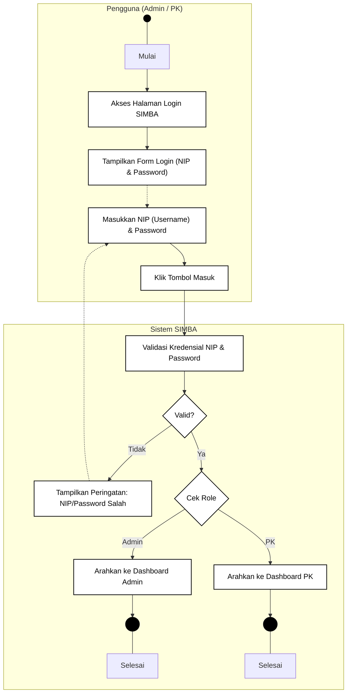

---

## 2. Activity Diagram: Tambah Surat Masuk (Admin / Bagian Umum)
Alur pengisian formulir surat masuk dan pengunggahan berkas digital (PDF) dengan validasi format:

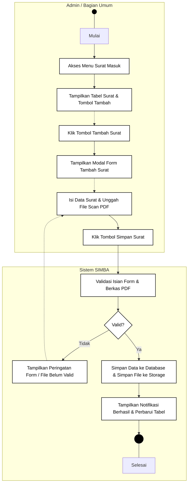

---

## 3. Activity Diagram: Lihat Detail & Unduh Surat Masuk (Admin)
Alur pembacaan rincian arsip surat kedinasan, pratinjau dokumen PDF langsung di browser, dan pengunduhan berkas:

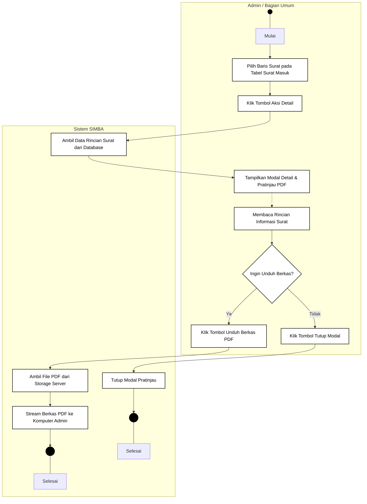

---

## 4. Activity Diagram: Hapus Surat Masuk (Admin / Bagian Umum)
Alur penghapusan arsip surat masuk dengan dialog konfirmasi keamanan serta pembersihan berkas scan fisik di server storage:

---

## 5. Activity Diagram: Tambah Surat Keluar (Admin / Bagian Umum)
Alur pencatatan surat dinas bapas yang ditujukan ke instansi luar dan penyimpanan arsip digital PDF:

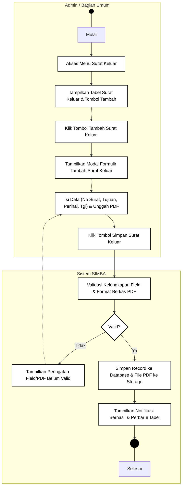

---

## 6. Activity Diagram: Lihat Detail & Unduh Surat Keluar (Admin)
Alur verifikasi isi surat keluar, pratinjau dokumen PDF, dan pengunduhan berkas:

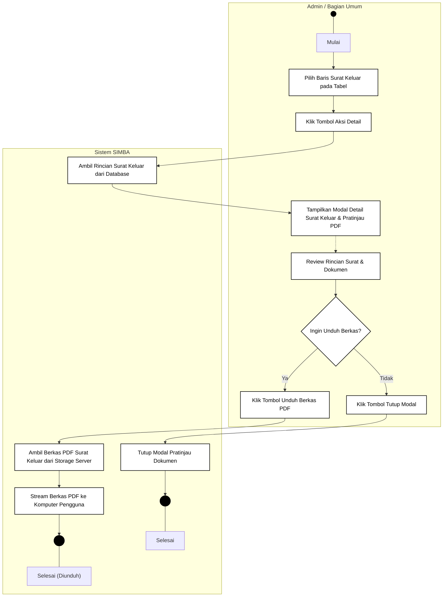

---

## 7. Activity Diagram: Hapus Surat Keluar (Admin / Bagian Umum)
Alur penghapusan surat keluar dan penghapusan berkas scan terkait dari folder server:

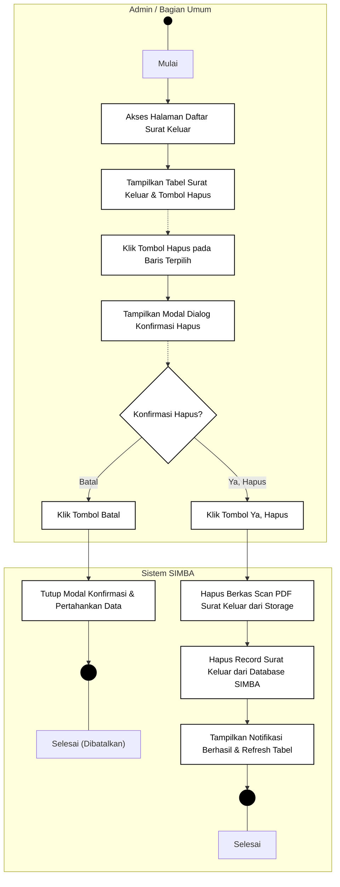

---

## 8. Activity Diagram: Pendaftaran Klien Pemasyarakatan Baru (PK)
Alur pendaftaran master klien bapas *(tanpa jenis bimbingan)* dan penambahan otomatis nilai metrik Total Klien pada Dashboard PK:

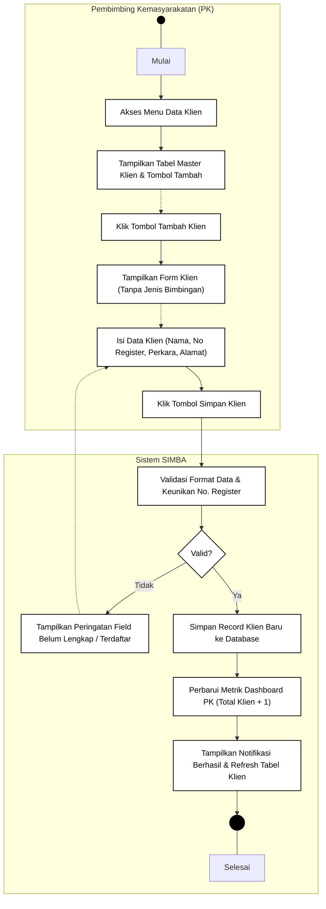

---

## 9. Activity Diagram: Hapus Data Klien Pemasyarakatan (PK)
Alur penghapusan data klien dengan proteksi modal konfirmasi, pembersihan riwayat bimbingan/presensi terkait di database, serta pembaruan otomatis penurunan metrik Total Klien pada Dashboard PK:

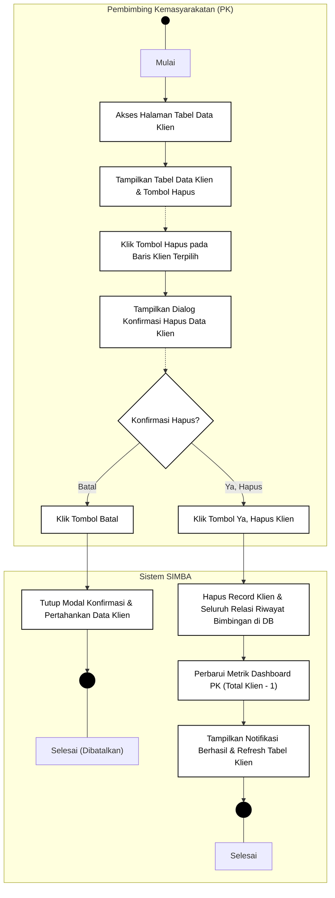

---

## 10. Activity Diagram: Pengaturan Jadwal Ketersediaan Bimbingan (PK)
Alur penentuan hari dan jam mulai bimbingan oleh PK *(tanpa kuota dan tanpa jam selesai)*:

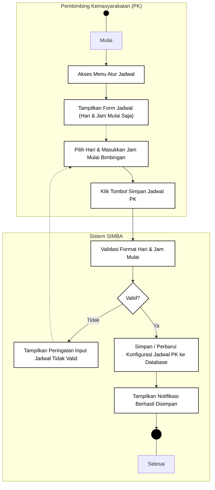

---

## 11. Activity Diagram: Penjadwalan Pertemuan Bimbingan Klien (PK)
Alur pembuatan jadwal bimbingan tatap muka klien dan pembaruan otomatis metrik Jadwal Hari Ini & Jadwal Minggu Ini:

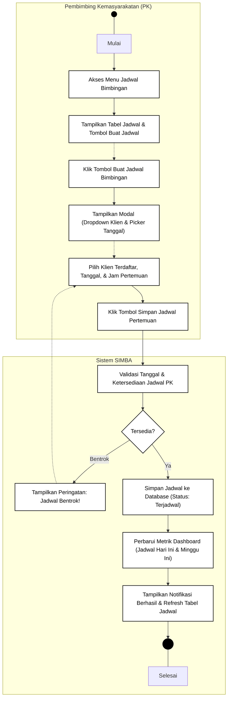

---

## 12. Activity Diagram: Pencatatan Bukti Kehadiran Klien / Wajib Lapor (PK)
Alur verifikasi wajib lapor fisik klien, unggah berkas foto fisik kehadiran, catatan evaluasi, hingga otomasi status pertemuan menjadi "Selesai":

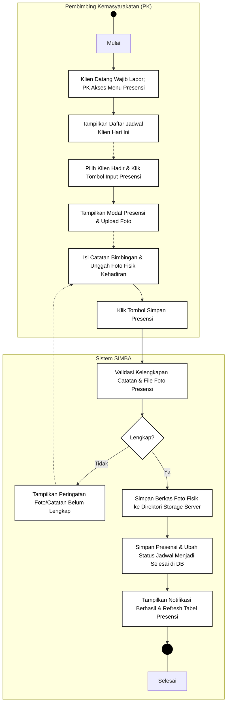

---

## Ringkasan Ketentuan Desain Visual & UML

1. **Hitam Putih Murni (*Black & White*)**:
   - Initial Node (Start State): Lingkaran solid hitam (`fillColor=#000000`).
   - Final Node (End State): Lingkaran dengan lingkaran ganda / bullseye (`shape=endState;fillColor=#000000;strokeColor=#000000`).
   - Action / Activity: Persegi panjang bersudut melengkung (*rounded rectangle*) dengan latar putih (`fillColor=#ffffff`) dan garis tepi hitam (`strokeColor=#000000;strokeWidth=1.5`).
   - Decision Node: Belah ketupat (*rhombus*) dengan garis tepi hitam tegas.
   - Swimlane: Pembatas vertikal kolom (*lane*) jelas antara peran pengguna (*Pengguna / Admin / PK*) dan *Sistem SIMBA*.

2. **Bebas Tabrakan Garis (*Zero Line Collision*)**:
   - Seluruh konektor panah dialirkan menggunakan *orthogonal routing* dengan titik belok (*waypoints*) yang terdefinisi pada ruang bebas di tepi luar kanvas (*margin lane*).
   - Jalur alternatif pembatalan (*Batal*) dan kegagalan validasi diposisikan simetris tanpa memotong elemen aktif lainnya.
