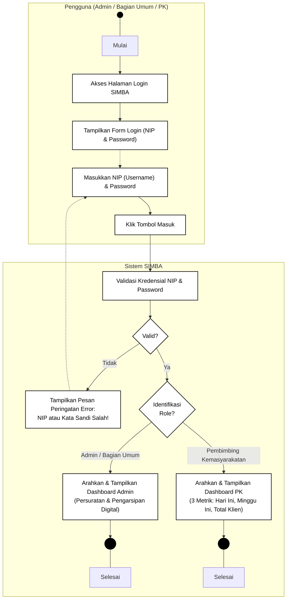
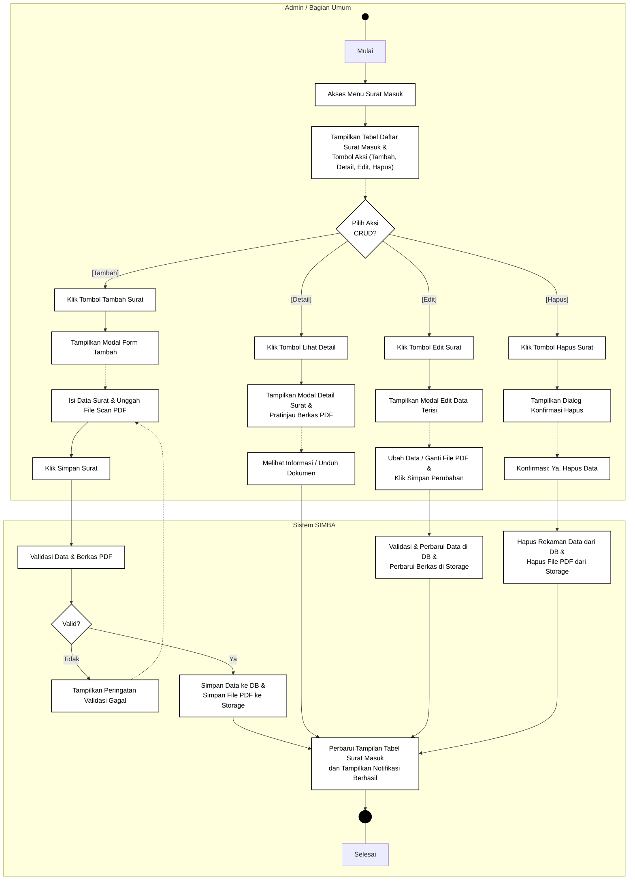
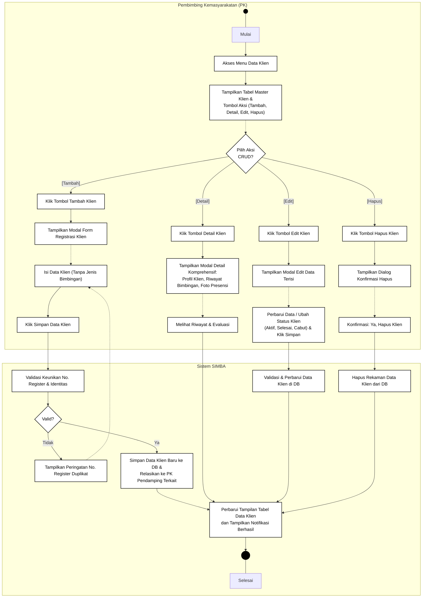

# Spesifikasi & Activity Diagram Lengkap - Sistem Informasi SIMBA
**Balai Pemasyarakatan (Bapas) Kelas I Banjarmasin**

> [!NOTE]
> Seluruh diagram dibuat dalam format **Hitam Putih (Black & White)** tanpa warna.
> 
> File Draw.io siap buka/edit tersedia di:
> - [`c:\laragon\www\SIMBA\diagram\activity_diagram_simba.drawio`](file:///c:/laragon/www/SIMBA/diagram/activity_diagram_simba.drawio)
> 
> *Struktur 6 Tab Sheet Lengkap di Draw.io:*
> 1. `1. Login Sistem (Multi-Role)`: **Alur Autentikasi Login Utama Pengguna (Admin & PK)** dari Mulai, Validasi NIP & Password, hingga Masuk Dashboard Selesai.
> 2. `2. CRUD Surat Masuk (Admin)`: Percabangan 4 Aksi (Tambah, Lihat Detail & Unduh PDF, Edit Data/File, Hapus).
> 3. `3. CRUD Surat Keluar (Admin)`: Percabangan 4 Aksi (Tambah, Lihat Detail & Unduh PDF, Edit Data/File, Hapus).
> 4. `4. CRUD Data Klien (PK)`: Percabangan 4 Aksi (Tambah Klien Baru, Detail Profil & Histori, Edit Status, Hapus).
> 5. `5. CRUD Jadwal Bimbingan (PK)`: Percabangan 4 Aksi (Tambah Jadwal, Detail Agenda, Reschedule/Edit, Batalkan/Hapus).
> 6. `6. Pencatatan Kehadiran Klien (PK)`: Upload Foto Fisik Presensi, Catatan Evaluasi, Update Status Selesai.

---

## 1. Activity Diagram: Login Sistem (Multi-Role Admin & PK)
Diagram ini menggambarkan alur gerbang masuk utama seluruh pengguna ke dalam sistem SIMBA menggunakan kredensial **NIP (sebagai username)** dan **Password**:

---

## 2. Activity Diagram: CRUD Surat Masuk (Admin / Bagian Umum)
Diagram ini menggambarkan alur kerja Admin Bagian Umum pada tabel surat masuk dengan 4 percabangan aksi CRUD:

---

## 3. Activity Diagram: CRUD Data Klien Pemasyarakatan (PK)
Diagram ini menggambarkan alur kerja Pembimbing Kemasyarakatan dalam mengelola master data klien bapas dengan 4 percabangan aksi CRUD:

