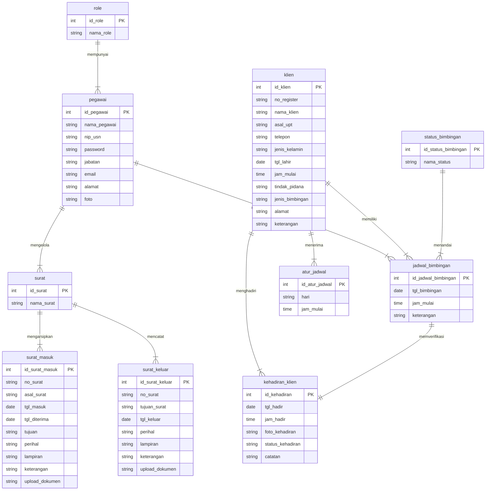

# Spesifikasi Conceptual Data Model (CDM) Sistem Informasi SIMBA
**Balai Pemasyarakatan (Bapas) Kelas I Banjarmasin**

> [!NOTE]
> Diagram CDM (*Conceptual Data Model*) ini dibangun berdasarkan **ERD Mutakhir SIMBA** dan mengikuti standar visual **PowerDesigner CDM (Format Cyan `#E5FFFF` / `#00AAAA`)** dengan **Tata Letak Bebas Tabrakan (*Zero Line Collision*)**:
> 1. **Struktur Entitas 3 Kompartemen**:
>    - **Baris Judul (*Entity Name*)**: Berisi nama entitas dengan teks tebal (*bold*) rata tengah, berlatar cyan (`#E5FFFF`) dengan garis batas *cyan* (`#00AAAA`).
>    - **Daftar Atribut (*Attributes*)**: Berisi atribut konseptual murni entitas dengan *Primary Identifier* / kunci utama bergaris bawah (`<u>nama_id</u>`).
>    - **Baris Identifier (*Primary Identifier*)**: Berisi label penanda kunci identitas primer: `identifier_1   <pi>` di bagian paling bawah.
> 2. **Prinsip Konseptual CDM (Tanpa Redundansi Foreign Key)**:
>    - Kolom *Foreign Key* (FK) seperti `id_role` pada entitas `pegawai` atau `id_klien` pada `jadwal_bimbingan` **tidak dicantumkan sebagai atribut entitas**.
>    - Keterhubungan antar entitas direpresentasikan murni oleh garis relasi konseptual. Kolom FK baru akan digenerate secara otomatis pada LDM (*Logical Data Model*) dan PDM (*Physical Data Model*).
> 3. **Notasi Kardinalitas Relasi PowerDesigner CDM**:
>    - Tanda garis tegak lurus `|` (*Mandatory One / ERone*): Kardinalitas tepat satu (1,1).
>    - Tanda cakar gagak bergaris `>-|` (*Mandatory Many / ERoneToMany*): Kardinalitas satu ke banyak (1,n).
>    - Setiap garis relasi memuat kata kerja predikat relasi (misal: *mempunyai*, *mengelola*, *menjadwalkan*, *memiliki*, *menghadiri*, dll.).
> 4. **Bebas Tabrakan Garis (*Zero Line Collision*)**:
>    - Menggunakan kisi terstruktur 3-level (*Top Masters*, *Middle Operations*, *Bottom Downstream Execution*) sehingga seluruh 10 garis relasi terhubung bersih tanpa ada yang saling memotong (*zero crossing*) maupun menabrak kotak entitas lain.

---

## Berkas Diagram yang Tersedia

Diagram CDM tersimpan pada direktori [`diagram/`](file:///c:/laragon/www/SIMBA/diagram):

| No | Nama Berkas | Tipe Berkas | Deskripsi & Lokasi Akses |
|---|---|---|---|
| 1 | **[`cdm_simba.drawio`](file:///c:/laragon/www/SIMBA/diagram/cdm_simba.drawio)** | Standalone Draw.io | Berkas mandiri Draw.io khusus CDM SIMBA untuk dibuka & diedit langsung di VS Code. |
| 2 | **[`cdm_simba.svg`](file:///c:/laragon/www/SIMBA/diagram/cdm_simba.svg)** | Vektor SVG Standar | Gambar vektor resolusi tinggi siap pratinjau langsung di peramban web maupun laporan dokumen. |
| 3 | **[`cdm_simba.png`](file:///c:/laragon/www/SIMBA/diagram/cdm_simba.png)** | Raster PNG | Berkas gambar PNG resolusi tinggi siap disematkan ke dalam laporan/skripsi. |

---

## 1. Visualisasi Mermaid CDM SIMBA

Diagram hubungan konseptual antar entitas SIMBA dirangkum dalam bagan berikut:

---

## 2. Kamus Atribut Konseptual (CDM)

| Entitas | Daftar Atribut Konseptual (*Primary Identifier* Bergaris Bawah) | Identifier Primer | Keterangan Relasional Konseptual |
|---|---|---|---|
| **`role`** | `<u>id_role</u>`, `nama_role` | `identifier_1 <pi>` | Mempunyai kardinalitas $1..n$ ke `pegawai`. |
| **`pegawai`** | `<u>id_pegawai</u>`, `nama_pegawai`, `nip_usn`, `password`, `jabatan`, `email`, `alamat`, `foto` | `identifier_1 <pi>` | Dihubungkan ke `role` (mempunyai), `jadwal_bimbingan` (menjadwalkan), dan `surat` (mengelola). |
| **`surat`** | `<u>id_surat</u>`, `nama_surat` | `identifier_1 <pi>` | Menghubungkan pegawai dengan arsip `surat_masuk` dan `surat_keluar`. |
| **`surat_masuk`** | `<u>id_surat_masuk</u>`, `no_surat`, `asal_surat`, `tgl_masuk`, `tgl_diterima`, `tujuan`, `perihal`, `lampiran`, `keterangan`, `upload_dokumen` | `identifier_1 <pi>` | Diarsipkan di bawah klasifikasi `surat`. |
| **`surat_keluar`** | `<u>id_surat_keluar</u>`, `no_surat`, `tujuan_surat`, `tgl_keluar`, `perihal`, `lampiran`, `keterangan`, `upload_dokumen` | `identifier_1 <pi>` | Dicatat di bawah klasifikasi `surat`. |
| **`klien`** | `<u>id_klien</u>`, `no_register`, `nama_klien`, `asal_upt`, `telepon`, `jenis_kelamin`, `tgl_lahir`, `jam_mulai`, `tindak_pidana`, `jenis_bimbingan`, `alamat`, `keterangan` | `identifier_1 <pi>` | Pusat entitas pembimbingan; berelasi ke `atur_jadwal`, `jadwal_bimbingan`, dan `kehadiran_klien`. |
| **`atur_jadwal`** | `<u>id_atur_jadwal</u>`, `hari`, `jam_mulai` | `identifier_1 <pi>` | Preferensi waktu layanan bimbingan mingguan yang diterima klien. |
| **`status_bimbingan`** | `<u>id_status_bimbingan</u>`, `nama_status` | `identifier_1 <pi>` | Master status penanda progres jadwal pembimbingan. |
| **`jadwal_bimbingan`** | `<u>id_jadwal_bimbingan</u>`, `tgl_bimbingan`, `jam_mulai`, `keterangan` | `identifier_1 <pi>` | Transaksi agenda bimbingan tatap muka; diverifikasi oleh rekaman kehadiran. |
| **`kehadiran_klien`** | `<u>id_kehadiran</u>`, `tgl_hadir`, `jam_hadir`, `foto_kehadiran`, `status_kehadiran`, `catatan` | `identifier_1 <pi>` | Log presensi wajib lapor klien pemasyarakatan. |

---

## 3. Matriks Kardinalitas Relasi PowerDesigner CDM

| No | Relasi | Dari Entitas (Parent) | Kardinalitas | Ke Entitas (Child) | Simbol Start (Parent) | Simbol End (Child) | Penjelasan Aturan Bisnis |
|---|---|---|---|---|---|---|---|
| 1 | `mempunyai` | `role` | $1 : N$ | `pegawai` | `|` (*Mandatory One*) | `>-|` (*Mandatory Many*) | Setiap pegawai wajib terdaftar dalam 1 role hak akses. |
| 2 | `mengelola` | `pegawai` | $1 : N$ | `surat` | `|` (*Mandatory One*) | `>-|` (*Mandatory Many*) | Petugas mengelola klasifikasi surat dinas. |
| 3 | `mengarsipkan` | `surat` | $1 : N$ | `surat_masuk` | `|` (*Mandatory One*) | `>-|` (*Mandatory Many*) | Setiap surat masuk diarsipkan ke 1 jenis surat. |
| 4 | `mencatat` | `surat` | $1 : N$ | `surat_keluar` | `|` (*Mandatory One*) | `>-|` (*Mandatory Many*) | Setiap surat keluar dicatat ke 1 jenis surat. |
| 5 | `menjadwalkan` | `pegawai` | $1 : N$ | `jadwal_bimbingan` | `|` (*Mandatory One*) | `>-|` (*Mandatory Many*) | Pembimbing Kemasyarakatan (PK) menetapkan jadwal. |
| 6 | `menandai` | `status_bimbingan` | $1 : N$ | `jadwal_bimbingan` | `|` (*Mandatory One*) | `>-|` (*Mandatory Many*) | Status bimbingan menandai kondisi pertemuan. |
| 7 | `menerima` | `klien` | $1 : N$ | `atur_jadwal` | `|` (*Mandatory One*) | `>-|` (*Mandatory Many*) | Klien menerima pengaturan jadwal wajib lapor. |
| 8 | `memiliki` | `klien` | $1 : N$ | `jadwal_bimbingan` | `|` (*Mandatory One*) | `>-|` (*Mandatory Many*) | Klien memiliki agenda bimbingan berkala. |
| 9 | `menghadiri` | `klien` | $1 : N$ | `kehadiran_klien` | `|` (*Mandatory One*) | `>-|` (*Mandatory Many*) | Klien menghadiri pencatatan absensi tatap muka. |
| 10 | `memverifikasi` | `jadwal_bimbingan` | $1 : 1$ | `kehadiran_klien` | `|` (*Mandatory One*) | `|` (*Mandatory One*) | Jadwal bimbingan diverifikasi oleh rekaman presensi. |
