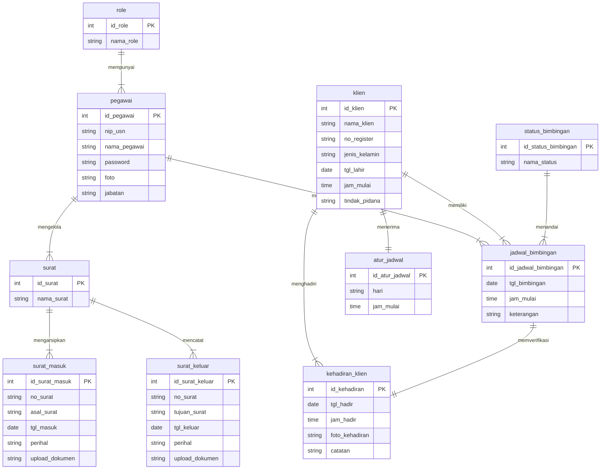

# Spesifikasi Conceptual Data Model (CDM) Sistem Informasi SIMBA
**Balai Pemasyarakatan (Bapas) Kelas I Banjarmasin**

> [!NOTE]
> Diagram CDM (*Conceptual Data Model*) ini dibangun berdasarkan **ERD Fiks SIMBA** dan mengikuti standar visual **PowerDesigner CDM (Format Biru Muda/Cyan)** persis sesuai contoh referensi yang diberikan:
> 1. **Struktur Entitas 3 Kompartemen**:
>    - **Baris Judul (*Entity Name*)**: Berisi nama entitas dengan teks tebal (*bold*) rata tengah, berlatar biru muda/cyan (`#E5FFFF`) dengan garis batas *cyan* (`#00AAAA`).
>    - **Daftar Atribut (*Attributes*)**: Berisi atribut konseptual entitas dengan *Primary Identifier* / kunci utama bergaris bawah (`<u>nama_id</u>`).
>    - **Baris Identifier (*Primary Identifier*)**: Berisi label penanda kunci identitas primer: `identifier_1   <pi>` di bagian paling bawah.
> 2. **Prinsip Konseptual CDM (Tanpa Redundansi Foreign Key)**:
>    - Pada model konseptual (CDM), kolom *Foreign Key* (FK) seperti `id_role` pada entitas `pegawai` atau `id_klien` pada `jadwal_bimbingan` **tidak dicantumkan sebagai atribut entitas**.
>    - Keterhubungan antar entitas direpresentasikan secara murni oleh garis relasi konseptual. Kolom FK baru akan digenerate otomatis saat ditransformasikan ke LDM (*Logical Data Model*) dan PDM (*Physical Data Model*).
> 3. **Notasi Kardinalitas Relasi PowerDesigner CDM**:
>    - Tanda garis tegak lurus `|` (*Mandatory One / ERone*): Menandakan kardinalitas tepat satu (1).
>    - Tanda cakar gagak bergaris `>-|` (*Mandatory Many / ERoneToMany*): Menandakan kardinalitas satu ke banyak ($1..n$).
>    - Setiap garis relasi memuat kata kerja predikat relasi (misal: *mempunyai*, *mengelola*, *menjadwalkan*, *memiliki*, dll.).

---

## Berkas Diagram yang Tersedia

Diagram CDM telah diintegrasikan langsung ke dalam repositori lokal SIMBA pada direktori [`diagram/`](file:///c:/laragon/www/SIMBA/diagram):

| No | Nama Berkas | Tipe Berkas | Deskripsi & Lokasi Akses |
|---|---|---|---|
| 1 | **[`erd_baru.drawio`](file:///c:/laragon/www/SIMBA/diagram/erd_baru.drawio)** | Multi-Sheet Draw.io | Tab sheet **`CDM`** telah diisi lengkap dengan 10 entitas & 10 relasi konseptual. |
| 2 | **[`cdm_simba.drawio`](file:///c:/laragon/www/SIMBA/diagram/cdm_simba.drawio)** | Standalone Draw.io | Berkas mandiri Draw.io khusus CDM SIMBA untuk dibuka & diedit langsung di VS Code. |
| 3 | **[`cdm_simba.svg`](file:///c:/laragon/www/SIMBA/diagram/cdm_simba.svg)** | Vektor SVG Standar | Gambar vektor resolusi tinggi siap pratinjau langsung di peramban web maupun laporan dokumen. |

---

## 1. Visualisasi Mermaid CDM SIMBA

Diagram hubungan konseptual antar entitas SIMBA dirangkum dalam bagan berikut:



---

## 2. Kamus Data Konseptual Entitas (*Entity Dictionary*)

Berikut daftar 10 entitas pada CDM SIMBA berserta atribut konseptual dan identitas primernya (*Primary Identifier* `<pi>`):

### 1. Entitas `role`
- **Deskripsi**: Menyimpan data tingkatan kewenangan akses pengguna pada sistem SIMBA (misalnya: *Administrator*, *Pembimbing Kemasyarakatan / PK*).
- **Primary Identifier (`<pi>`)**: `id_role`
- **Atribut Konseptual**:
  - `id_role` *(underlined / `<pi>`)*
  - `nama_role`
- **Bagian Bawah**: `identifier_1  <pi>`

### 2. Entitas `pegawai`
- **Deskripsi**: Menyimpan data identitas aparatur pegawai Bapas Kelas I Banjarmasin yang bertugas mengelola sistem persuratan maupun pembimbingan klien.
- **Primary Identifier (`<pi>`)**: `id_pegawai`
- **Atribut Konseptual**:
  - `id_pegawai` *(underlined / `<pi>`)*
  - `nama_pegawai`
  - `nip(usn)`
  - `jabatan`
  - `password`
  - `foto`
- **Bagian Bawah**: `identifier_1  <pi>`

### 3. Entitas `surat`
- **Deskripsi**: Entitas induk/kategori persuratan dinas pada Bapas Banjarmasin yang mengelompokkan arsip surat masuk dan arsip surat keluar.
- **Primary Identifier (`<pi>`)**: `id_surat`
- **Atribut Konseptual**:
  - `id_surat` *(underlined / `<pi>`)*
  - `nama_surat`
- **Bagian Bawah**: `identifier_1  <pi>`

### 4. Entitas `surat_masuk`
- **Deskripsi**: Menyimpan arsip dokumen surat dinas yang diterima oleh Bapas Banjarmasin dari instansi luar atau satuan kerja penegak hukum.
- **Primary Identifier (`<pi>`)**: `id_surat_masuk`
- **Atribut Konseptual**:
  - `id_surat_masuk` *(underlined / `<pi>`)*
  - `no_surat`
  - `asal_surat`
  - `tgl_masuk`
  - `perihal`
  - `upload_dokumen`
- **Bagian Bawah**: `identifier_1  <pi>`

### 5. Entitas `surat_keluar`
- **Deskripsi**: Menyimpan arsip dokumen surat dinas yang diterbitkan oleh Bapas Banjarmasin untuk dikirimkan ke pihak eksternal.
- **Primary Identifier (`<pi>`)**: `id_surat_keluar`
- **Atribut Konseptual**:
  - `id_surat_keluar` *(underlined / `<pi>`)*
  - `no_surat`
  - `tujuan_surat`
  - `tgl_keluar`
  - `perihal`
  - `upload_dokumen`
- **Bagian Bawah**: `identifier_1  <pi>`

### 6. Entitas `klien`
- **Deskripsi**: Menyimpan data pokok warga binaan pemasyarakatan / klien binaan yang menjalani program wajib lapor dan pembimbingan di Bapas Banjarmasin.
- **Primary Identifier (`<pi>`)**: `id_klien`
- **Atribut Konseptual**:
  - `id_klien` *(underlined / `<pi>`)*
  - `nama_klien`
  - `no_register`
  - `jenis_kelamin`
  - `tgl_lahir`
  - `jam_mulai`
  - `tindak_pidana`
- **Bagian Bawah**: `identifier_1  <pi>`

### 7. Entitas `atur_jadwal`
- **Deskripsi**: Menyimpan aturan penetapan waktu rutin pembimbingan klien binaan (hari dan jam wajib lapor).
- **Primary Identifier (`<pi>`)**: `id_atur_jadwal`
- **Atribut Konseptual**:
  - `id_atur_jadwal` *(underlined / `<pi>`)*
  - `hari`
  - `jam_mulai`
- **Bagian Bawah**: `identifier_1  <pi>`

### 8. Entitas `jadwal_bimbingan`
- **Deskripsi**: Menyimpan data agenda sesi pelaksanaan bimbingan kemasyarakatan pada tanggal dan jam tertentu untuk klien binaan bersama pegawai PK pembimbing.
- **Primary Identifier (`<pi>`)**: `id_jadwal_bimbingan`
- **Atribut Konseptual**:
  - `id_jadwal_bimbingan` *(underlined / `<pi>`)*
  - `tgl_bimbingan`
  - `jam_mulai`
  - `keterangan`
- **Bagian Bawah**: `identifier_1  <pi>`

### 9. Entitas `status_bimbingan`
- **Deskripsi**: Menyimpan daftar referensi status pelaksanaan sesi pembimbingan (misal: *Menunggu*, *Terlaksana*, *Tidak Hadir*, *Ditunda*).
- **Primary Identifier (`<pi>`)**: `id_status_bimbingan`
- **Atribut Konseptual**:
  - `id_status_bimbingan` *(underlined / `<pi>`)*
  - `nama_status`
- **Bagian Bawah**: `identifier_1  <pi>`

### 10. Entitas `kehadiran_klien`
- **Deskripsi**: Menyimpan rekaman absensi kehadiran klien saat melakukan wajib lapor/bimbingan di Bapas Banjarmasin, dilengkapi jam hadir fisik, bukti foto kehadiran, dan catatan evaluasi.
- **Primary Identifier (`<pi>`)**: `id_kehadiran`
- **Atribut Konseptual**:
  - `id_kehadiran` *(underlined / `<pi>`)*
  - `tgl_hadir`
  - `jam_hadir`
  - `foto_kehadiran`
  - `catatan`
- **Bagian Bawah**: `identifier_1  <pi>`

---

## 3. Matriks Relasi Antar Entitas (*Relationship Matrix*)

| No | Entitas Asal | Predikat Relasi | Entitas Tujuan | Kardinalitas CDM | Aturan Bisnis Pemasyarakatan |
|:--:|---|:---:|---|:---:|---|
| 1 | `role` | **mempunyai** | `pegawai` | $1 \rightarrow N$ (`\|` ke `>-|`) | Satu *Role* kewenangan dapat dimiliki oleh banyak pegawai; setiap pegawai memiliki tepat satu role akses. |
| 2 | `pegawai` | **mengelola** | `surat` | $1 \rightarrow N$ (`\|` ke `>-|`) | Pegawai staf tata usaha / pengelola arsip mengelola berbagai klasifikasi surat dinas. |
| 3 | `surat` | **mengarsipkan** | `surat_masuk` | $1 \rightarrow N$ (`\|` ke `>-|`) | Klasifikasi surat dinas menaungi pengarsipan banyak data surat masuk. |
| 4 | `surat` | **mencatat** | `surat_keluar` | $1 \rightarrow N$ (`\|` ke `>-|`) | Klasifikasi surat dinas menaungi pencatatan banyak data surat keluar. |
| 5 | `pegawai` | **menjadwalkan** | `jadwal_bimbingan` | $1 \rightarrow N$ (`\|` ke `>-|`) | Pegawai Pembimbing Kemasyarakatan (PK) menjadwalkan agenda bimbingan klien binaannya. |
| 6 | `atur_jadwal` | **menerima** | `klien` | $1 \rightarrow 1$ (`\|` ke `\|`) | Setiap klien binaan menerima satu penetapan jadwal rutin wajib lapor di Bapas. |
| 7 | `klien` | **memiliki** | `jadwal_bimbingan` | $1 \rightarrow N$ (`\|` ke `>-|`) | Satu klien binaan memiliki riwayat banyak jadwal sesi bimbingan selama masa pembinaan. |
| 8 | `status_bimbingan` | **menandai** | `jadwal_bimbingan` | $1 \rightarrow N$ (`\|` ke `>-|`) | Status bimbingan digunakan untuk menandai progres status pada setiap sesi jadwal bimbingan. |
| 9 | `jadwal_bimbingan` | **memverifikasi** | `kehadiran_klien` | $1 \rightarrow 1$ (`\|` ke `\|`) | Sesi jadwal bimbingan diverifikasi realisasinya melalui satu rekaman bukti kehadiran klien. |
| 10 | `klien` | **menghadiri** | `kehadiran_klien` | $1 \rightarrow N$ (`\|` ke `>-|`) | Klien binaan melakukan presensi kehadiran berkali-kali sesuai kewajiban masa wajib lapornya. |

---

## 4. Perbedaan Mendasar ERD vs CDM pada SIMBA

1. **Notasi Chen vs Notasi PowerDesigner CDM**:
   - Pada **ERD Chen** (`erd_baru.png`), setiap atribut digambarkan sebagai *elips* yang menempel pada entitas persegi panjang, dan relasi digambarkan sebagai *belah ketupat* (*rhombus*).
   - Pada **CDM PowerDesigner** (`cdm_simba.drawio`), setiap entitas digambarkan sebagai satu kesatuan kotak tabel 3 kompartemen bergaris tepi *cyan* (`#00AAAA`) dan latar *pale cyan* (`#E5FFFF`).
2. **Penghapusan Kolom Foreign Key Redundan**:
   - Pada ERD Chen awal, seringkali foreign key seperti `id_role` atau `id_klien` dituliskan langsung sebagai atribut di entitas anak.
   - Pada standar resmi CDM, foreign key **dihilangkan dari atribut entitas** karena relasi asosiasilah yang menjadi jembatan konseptualnya. Foreign key baru akan digenerate saat perancangan fisik basis data (PDM / SQL DDL).
3. **Penyajian Primary Identifier**:
   - Di bagian bawah kotak entitas selalu tercantum keterangan `identifier_1  <pi>` (*Primary Identifier*) untuk menegaskan kunci unik logis entitas.

---

## 5. Panduan Membuka & Mengedit di VS Code / Git CLI

### Membuka di VS Code
Karena ekstensi Draw.io (`hediet.vscode-drawio`) telah terpasang di VS Code Anda, Anda cukup:
1. Klik berkas [`diagram/cdm_simba.drawio`](file:///c:/laragon/www/SIMBA/diagram/cdm_simba.drawio) atau [`diagram/erd_baru.drawio`](file:///c:/laragon/www/SIMBA/diagram/erd_baru.drawio) pada *Explorer* VS Code.
2. Diagram interaktif langsung terbuka di editor VS Code dengan semua simbol, warna, dan relasi yang dapat digeser atau disesuaikan.
3. Pada `erd_baru.drawio`, klik *tab sheet* bertuliskan **`CDM`** di bagian bawah kanvas editor.

### Perintah Melalui Git / GitHub CLI di Komputer Anda
Untuk menambahkan dan melakukan *commit* perubahan diagram ini ke repositori Git SIMBA:

```bash
# Cek status berkas diagram
git status

# Tambahkan perubahan berkas diagram CDM ke staging area
git add diagram/erd_baru.drawio diagram/cdm_simba.drawio diagram/cdm_simba.svg diagram/cdm_simba.md

# Lakukan commit dengan pesan deskriptif
git commit -m "feat(diagram): tambahkan CDM SIMBA berbasis ERD fiks dengan notasi PowerDesigner"

# Jika ingin push ke repositori GitHub (jika kredensial/gh auth telah aktif)
git push origin main
```
