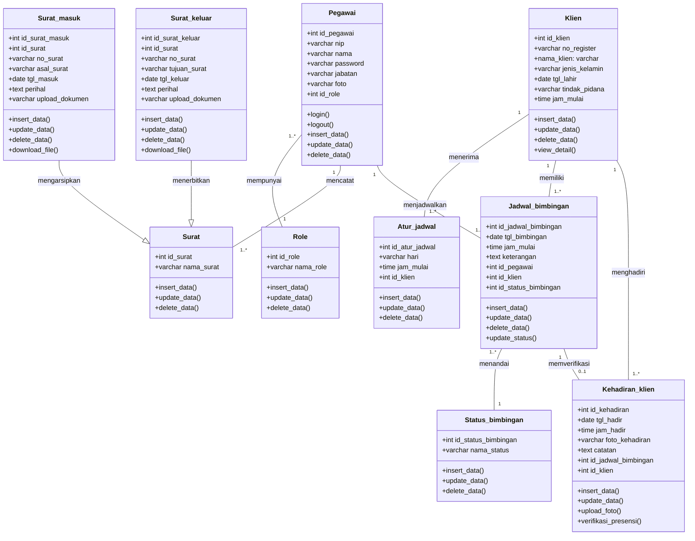

# Spesifikasi Class Diagram Sistem Informasi SIMBA
**Balai Pemasyarakatan (Bapas) Kelas I Banjarmasin**

> [!NOTE]
> Class Diagram ini dirancang berdasarkan **ERD Fiks SIMBA** dan mengikuti standar notasi UML persis sesuai contoh referensi yang diberikan:
> - **Format 3 Kompartemen (UML Class Box)**:
>   1. **Nama Kelas (*Class Name*)**: Baris judul kelas dengan warna *header teal* (`#17a2b8` / `#20b2aa`) atau hitam putih resmi.
>   2. **Daftar Atribut (*Attributes*)**: Notasi visibilitas publik `+`, nama field/kolom, dan tipe data (`+ nama_atribut: tipe_data`).
>   3. **Daftar Operasi / Metode (*Methods / Operations*)**: Notasi visibilitas publik `+`, nama fungsi, dan parameter (`+ insert_data()`, `+ update_data()`, `+ delete_data()`, dll.).
> - **Pewarisan / Generalisasi (*Inheritance*)**: Kelas induk `Surat` diturunkan menjadi `Surat_masuk` dan `Surat_keluar` dengan panah tertutup kosong (`--|>`), persis seperti contoh kelas `Buku` yang diturunkan menjadi `Buku_asing` dan `Buku_lokal`.
> - **Relasi Asosiasi & Multiplicity**: Dilengkapi kardinalitas relasi (`1`, `1..*`, `0..1`).

File diagram Draw.io siap buka dan langsung dapat diedit tersedia di:
- [`c:\laragon\www\SIMBA\diagram\class_diagram_simba.drawio`](file:///c:/laragon/www/SIMBA/diagram/class_diagram_simba.drawio)

---

## Struktur Lembar Kerja (*Sheet Tabs*) pada Draw.io

| No | Tab Sheet Draw.io | Format Tampilan | Deskripsi Diagram |
|---|---|---|---|
| 1 | **`1. Class Diagram (ERD Fiks)`** | Berwarna Sesuai Contoh (*Teal Header*) | Memetakan 10 entitas pada ERD Fiks SIMBA dengan pewarisan `Surat` $\rightarrow$ `Surat_masuk` & `Surat_keluar` sesuai contoh visual. |
| 2 | **`2. Class Diagram (Hitam Putih)`** | Format Standar Laporan Akademik | Versi monokrom / hitam putih murni tanpa warna untuk kebutuhan cetak skripsi / laporan PKL Politeknik Negeri Banjarmasin. |

---

## 1. Visualisasi Mermaid Class Diagram (Berdasarkan ERD Fiks)

---

## 2. Kamus Data & Deskripsi Kelas (10 Kelas Lengkap)

### 1. `Role`
- **Fungsi**: Menyimpan master kategori wewenang pengguna (Admin / Bagian Umum dan Pembimbing Kemasyarakatan).
- **Atribut**:
  - `+ id_role: int` (Primary Key)
  - `+ nama_role: varchar` (Nama role)
- **Metode**:
  - `+ insert_data()`: Menambahkan data role baru.
  - `+ update_data()`: Mengubah informasi nama role.
  - `+ delete_data()`: Menghapus data role.

### 2. `Pegawai`
- **Fungsi**: Entitas pengguna yang bertugas mengoperasikan SIMBA.
- **Atribut**:
  - `+ id_pegawai: int` (Primary Key)
  - `+ nip: varchar` (Nomor Induk Pegawai sebagai username login)
  - `+ nama: varchar` (Nama lengkap pegawai)
  - `+ password: varchar` (Hash kata sandi akun)
  - `+ jabatan: varchar` (Jabatan dinas di Bapas)
  - `+ foto: varchar` (Nama/path file foto profil)
  - `+ id_role: int` (Foreign Key merujuk ke tabel `Role`)
- **Metode**:
  - `+ login()`: Autentikasi akun & inisialisasi sesi.
  - `+ logout()`: Menghancurkan sesi pengguna aktif.
  - `+ insert_data()`, `+ update_data()`, `+ delete_data()`.

### 3. `Surat` (Kelas Induk / *Superclass*)
- **Fungsi**: Kelas generalisasi dari persuratan kedinasan Bapas Kelas I Banjarmasin.
- **Atribut**:
  - `+ id_surat: int` (Primary Key)
  - `+ nama_surat: varchar` (Nama klasifikasi surat)
- **Metode**:
  - `+ insert_data()`, `+ update_data()`, `+ delete_data()`.

### 4. `Surat_masuk` (Kelas Turunan / *Subclass* dari `Surat`)
- **Fungsi**: Mengelola pencatatan dan digitalisasi berkas naskah dinas masuk.
- **Atribut**:
  - `+ id_surat_masuk: int` (Primary Key)
  - `+ id_surat: int` (Foreign Key merujuk ke kelas induk `Surat`)
  - `+ no_surat: varchar` (Nomor naskah dinas surat masuk)
  - `+ asal_surat: varchar` (Instansi/pihak pengirim surat)
  - `+ tgl_masuk: date` (Tanggal penerimaan surat)
  - `+ perihal: text` (Ringkasan pokok isi surat)
  - `+ upload_dokumen: varchar` (Nama berkas scan PDF pada folder penyimpanan server)
- **Metode**:
  - `+ insert_data()`, `+ update_data()`, `+ delete_data()`.
  - `+ download_file()`: Mengunduh salinan berkas scan dokumen PDF.

### 5. `Surat_keluar` (Kelas Turunan / *Subclass* dari `Surat`)
- **Fungsi**: Mengelola register dan arsip digital surat dinas keluar.
- **Atribut**:
  - `+ id_surat_keluar: int` (Primary Key)
  - `+ id_surat: int` (Foreign Key merujuk ke kelas induk `Surat`)
  - `+ no_surat: varchar` (Nomor registrasi surat keluar)
  - `+ tujuan_surat: varchar` (Instansi/lembaga yang dituju)
  - `+ tgl_keluar: date` (Tanggal penerbitan/pengiriman surat)
  - `+ perihal: text` (Perihal pokok surat dinas)
  - `+ upload_dokumen: varchar` (Nama berkas scan PDF pada storage server)
- **Metode**:
  - `+ insert_data()`, `+ update_data()`, `+ delete_data()`, `+ download_file()`.

### 6. `Atur_jadwal`
- **Fungsi**: Mengatur ketersediaan waktu dan hari bimbingan klien oleh PK.
- **Atribut**:
  - `+ id_atur_jadwal: int` (Primary Key)
  - `+ hari: varchar` (Nama hari pelayanan, misal: "Senin", "Kamis")
  - `+ jam_mulai: time` (Waktu mulai sesi bimbingan)
  - `+ id_klien: int` (Foreign Key merujuk ke `Klien`)
- **Metode**:
  - `+ insert_data()`, `+ update_data()`, `+ delete_data()`.

### 7. `Klien`
- **Fungsi**: Menyimpan master data warga binaan pemasyarakatan yang dibimbing.
- **Atribut**:
  - `+ id_klien: int` (Primary Key)
  - `+ no_register: varchar` (Nomor registrasi resmi Bapas klien)
  - `+ nama_klien: varchar` (Nama lengkap klien pemasyarakatan)
  - `+ jenis_kelamin: varchar` (Laki-laki / Perempuan)
  - `+ tgl_lahir: date` (Tanggal lahir klien)
  - `+ tindak_pidana: varchar` (Kasus perkara hukum klien)
  - `+ jam_mulai: time` (Jam awal sesi bimbingan rutin)
- **Metode**:
  - `+ insert_data()`, `+ update_data()`, `+ delete_data()`, `+ view_detail()`.

### 8. `Jadwal_bimbingan`
- **Fungsi**: Mengatur jadwal sesi pertemuan konseling/bimbingan tatap muka klien.
- **Atribut**:
  - `+ id_jadwal_bimbingan: int` (Primary Key)
  - `+ tgl_bimbingan: date` (Tanggal pelaksanaan bimbingan)
  - `+ jam_mulai: time` (Waktu tatap muka dimulai)
  - `+ keterangan: text` (Catatan atau topik materi pembinaan)
  - `+ id_pegawai: int` (Foreign Key PK yang membimbing)
  - `+ id_klien: int` (Foreign Key klien yang dijadwalkan)
  - `+ id_status_bimbingan: int` (Foreign Key status bimbingan)
- **Metode**:
  - `+ insert_data()`, `+ update_data()`, `+ delete_data()`, `+ update_status()`.

### 9. `Status_bimbingan`
- **Fungsi**: Master data status tahapan bimbingan (misal: "Terjadwal", "Selesai", "Batal").
- **Atribut**:
  - `+ id_status_bimbingan: int` (Primary Key)
  - `+ nama_status: varchar` (Nama label status)
- **Metode**:
  - `+ insert_data()`, `+ update_data()`, `+ delete_data()`.

### 10. `Kehadiran_klien`
- **Fungsi**: Mencatat bukti kehadiran fisik wajib lapor klien dan catatan evaluasi PK.
- **Atribut**:
  - `+ id_kehadiran: int` (Primary Key)
  - `+ tgl_hadir: date` (Tanggal kehadiran aktual)
  - `+ jam_hadir: time` (Jam kedatangan aktual)
  - `+ foto_kehadiran: varchar` (Nama file foto bukti fisik pada folder `/storage/presensi/`)
  - `+ catatan: text` (Catatan evaluasi perkembangan bimbingan oleh PK)
  - `+ id_jadwal_bimbingan: int` (Foreign Key sesi jadwal)
  - `+ id_klien: int` (Foreign Key klien yang hadir)
- **Metode**:
  - `+ insert_data()`, `+ update_data()`, `+ upload_foto()`, `+ verifikasi_presensi()`.
