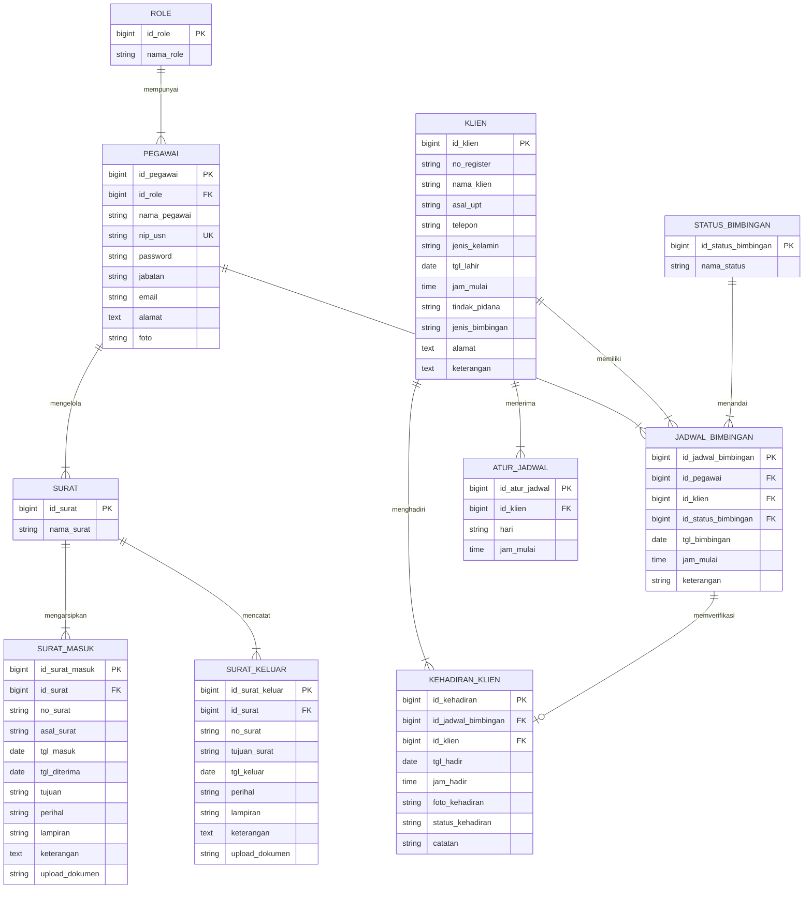

# Entity Relationship Diagram (ERD) Sistem Informasi SIMBA
**Balai Pemasyarakatan (Bapas) Kelas I Banjarmasin**

> [!NOTE]
> Berkas ERD ini (`erd_paling_baru`) merupakan pemutakhiran menyeluruh dari diagram ERD sebelumnya, yang telah **disinkronkan 100% dengan skema fisik basis data MySQL riil** pada aplikasi SIMBA (`simba` database & Laravel Migrations). Seluruh berkas diagram lama tetap dipertahankan utuh tanpa dihapus.

---

## 1. Daftar Berkas Diagram yang Tersedia

Seluruh berkas diagram baru telah disimpan di dalam direktori [`diagram/`](file:///c:/laragon/www/SIMBA/diagram):

| No | Nama Berkas | Format | Deskripsi & Kegunaan |
|---|---|---|---|
| 1 | **[`erd_paling_baru.drawio`](file:///c:/laragon/www/SIMBA/diagram/erd_paling_baru.drawio)** | Draw.io XML | Berkas mandiri Draw.io, siap dibuka dan diedit langsung melalui ekstensi VS Code (*Draw.io Integration*) maupun web Draw.io. |
| 2 | **[`erd_paling_baru.drawio.png`](file:///c:/laragon/www/SIMBA/diagram/erd_paling_baru.drawio.png)** | PNG + Draw.io XML | Gambar PNG yang memuat metadata XML Draw.io bawaan (*dual-purpose*). Dapat dibuka sebagai gambar biasa maupun diedit di Draw.io. |
| 3 | **[`erd_paling_baru.png`](file:///c:/laragon/www/SIMBA/diagram/erd_paling_baru.png)** | Raster PNG | Berkas gambar resolusi tinggi (2940 × 1590) untuk keperluan laporan, presentasi, atau dokumen akademik. |
| 4 | **[`erd_paling_baru.svg`](file:///c:/laragon/www/SIMBA/diagram/erd_paling_baru.svg)** | Vektor SVG Standar | Gambar vektor resolusi tinggi tanpa pecah (*lossless*), siap dipratinjau langsung di peramban web. |
| 5 | **[`erd_paling_baru.md`](file:///c:/laragon/www/SIMBA/diagram/erd_paling_baru.md)** | Markdown Dokumentasi | Spesifikasi teknis entitas, kamus data atribut, relasi kardinalitas, dan visualisasi Mermaid. |

---

## 2. Ringkasan Perubahan & Sinkronisasi dengan Basis Data Riil

Berdasarkan audit langsung pada basis data `simba` dan migrasi Laravel, berikut adalah rincian penyesuaian yang diterapkan pada **`erd_paling_baru`** dibandingkan diagram versi terdahulu:

| Entitas / Tabel | Kondisi Diagram Sebelumnya | Penyesuaian pada `erd_paling_baru` | Alasan Sinkronisasi Basis Data |
|---|---|---|---|
| **`atur_jadwal`** | Memuat atribut `tanggal` dan `keterangan` | Menjadi `hari` dan menghapus `keterangan` | Tabel `atur_jadwal` pada database hanya memiliki kolom `id_atur_jadwal`, `id_klien`, `hari`, dan `jam_mulai` (preferensi hari bimbingan mingguan). |
| **`jadwal_bimbingan`** | Memuat atribut `nomor_telepon` | Mengganti `nomor_telepon` menjadi `keterangan` | Tabel `jadwal_bimbingan` menyimpan `keterangan` bimbingan, bukan nomor telepon klien. |
| **`kehadiran_klien`** | Memuat `evaluasi`, belum ada `status_kehadiran`, garis `id_jadwal_bimbingan` terputus | Menjadi `catatan`, menambahkan `status_kehadiran`, dan menghubungkan `id_jadwal_bimbingan` | Kolom fisik pada tabel adalah `catatan` dan `status_kehadiran` (Hadir/Izin/Alpa). |
| **`klien`** | Menggunakan nama `nomor_telepon`, salah ketik `ketereangan`, belum memuat `tgl_lahir` dan `jam_mulai` | Mengubah ke `telepon`, membetulkan ejaan `keterangan`, serta menambahkan `tgl_lahir` dan `jam_mulai` | Menyinkronkan seluruh 12 kolom aktual tabel `klien` di database MySQL. |
| **`pegawai`** | Format `nip(usn)`, belum mencantumkan atribut `email` | Mengubah menjadi `nip_usn` dan menambahkan atribut `email` | Menyinkronkan kolom `nip_usn` dan kolom `email` hasil migrasi Figma. |
| **`surat`** | Memuat atribut `id_pegawai` di dalam entitas `surat` | Menghapus `id_pegawai` dari atribut entitas `surat` | Tabel `surat` pada database hanya terdiri dari `id_surat` dan `nama_surat`. Relasi dengan pegawai direpresentasikan oleh relasi `mengelola`. |
| **`surat_masuk`** | Menggunakan nama `tgl_surat_diterima` | Mengubah nama atribut menjadi `tgl_diterima` | Kolom fisik tabel adalah `tgl_diterima`. |
| **`surat_keluar`** | Belum mencantumkan `lampiran` dan `keterangan` | Menambahkan atribut `lampiran` dan `keterangan` | Sesuai dengan penambahan kolom pada migrasi `add_figma_fields`. |
| **Relasi Garis** | Garis `menerima` dan `memverifikasi` belum terhubung sempurna | Menghubungkan relasi `menerima` ke entitas `klien` dan `memverifikasi` ke `kehadiran_klien` | Memastikan integritas kardinalitas 10 relasi bisnis SIMBA utuh secara visual dan logis. |

---

## 3. Visualisasi ERD Menggunakan Mermaid

Diagram keterhubungan antar-entitas beserta atribut kunci primer (PK) dan kunci asing (FK) dapat dipratinjau di bawah ini:

---

## 4. Kamus Data & Spesifikasi 10 Entitas Fisik

Berikut adalah rincian lengkap atribut pada setiap entitas sesuai struktur kolom MySQL:

### 4.1 Entitas `role`
Menyimpan referensi tingkatan hak akses pengguna dalam sistem SIMBA.
- `id_role` (PK): Kunci utama integer otomatis (*Auto Increment*).
- `nama_role`: Nama hak akses (contoh: *Admin*, *Pembimbing Kemasyarakatan*).

### 4.2 Entitas `pegawai`
Menyimpan data akun dan profil pegawai Balai Pemasyarakatan.
- `id_pegawai` (PK): Kunci utama identitas pegawai.
- `id_role` (FK): Kunci tamu mengacu ke `role.id_role`.
- `nama_pegawai`: Nama lengkap pegawai beserta gelar.
- `nip_usn`: Nomor Induk Pegawai sekaligus username unik untuk autentikasi.
- `password`: Kata sandi terenkripsi (Bcrypt hash).
- `jabatan`: Nama formasi jabatan fungsional.
- `email`: Alamat surel resmi pegawai.
- `alamat`: Alamat domisili tempat tinggal pegawai.
- `foto`: Jalur berkas (*path*) penyimpanan foto profil pegawai.

### 4.3 Entitas `surat`
Menyimpan kategori klasifikasi jenis surat di lingkungan kantor Bapas.
- `id_surat` (PK): Kunci utama jenis surat.
- `nama_surat`: Nama klasifikasi jenis surat (contoh: *Surat Masuk*, *Surat Keluar*).

### 4.4 Entitas `surat_masuk`
Menyimpan log arsip surat dinas yang diterima dari instansi eksternal/UPT.
- `id_surat_masuk` (PK): Kunci utama pencatatan surat masuk.
- `id_surat` (FK): Kunci tamu jenis surat.
- `no_surat`: Nomor surat resmi instansi pengirim.
- `asal_surat`: Instansi/kantor asal pengirim surat.
- `tgl_masuk`: Tanggal surat dicatat masuk ke sistem.
- `tgl_diterima`: Tanggal fisik surat diterima di Bapas.
- `tujuan`: Pejabat/bagian tujuan disposisi surat.
- `perihal`: Pokok bahasan surat masuk.
- `lampiran`: Jumlah atau keterangan berkas lampiran.
- `keterangan`: Ringkasan/catatan disposisi surat.
- `upload_dokumen`: Jalur penyimpanan berkas dokumen pindaian (*scan* PDF).

### 4.5 Entitas `surat_keluar`
Menyimpan arsip surat dinas yang diterbitkan oleh Bapas ke instansi luar.
- `id_surat_keluar` (PK): Kunci utama pencatatan surat keluar.
- `id_surat` (FK): Kunci tamu jenis surat.
- `no_surat`: Nomor agenda resmi surat keluar.
- `tujuan_surat`: Instansi/tujuan pengiriman surat.
- `tgl_keluar`: Tanggal penerbitan surat dinas.
- `perihal`: Pokok perihal surat dinas keluar.
- `lampiran`: Informasi berkas lampiran pendukung.
- `keterangan`: Catatan tambahan dokumen keluar.
- `upload_dokumen`: Jalur penyimpanan berkas digital (*file* PDF surat keluar).

### 4.6 Entitas `klien`
Menyimpan data master klien pemasyarakatan yang menjalani masa bimbingan.
- `id_klien` (PK): Kunci utama identitas klien.
- `no_register`: Nomor registrasi pembimbingan klien.
- `nama_klien`: Nama lengkap klien pemasyarakatan.
- `asal_upt`: Asal Lembaga Pemasyarakatan (Lapas) atau Rutan pengirim.
- `telepon`: Nomor telepon/WhatsApp aktif klien atau penjamin.
- `jenis_kelamin`: Jenis kelamin (*Laki-laki* / *Perempuan*).
- `tgl_lahir`: Tanggal lahir klien pemasyarakatan.
- `jam_mulai`: Waktu mulai standar layanan bimbingan klien.
- `tindak_pidana`: Jenis perkara hukum/kejahatan (misal: *Narkotika*, *Pencurian*).
- `jenis_bimbingan`: Program integrasi pemasyarakatan (*PB*, *CB*, *CMB*, dll.).
- `alamat`: Alamat lengkap tempat tinggal klien.
- `keterangan`: Catatan khusus mengenai latar belakang klien.

### 4.7 Entitas `atur_jadwal`
Menyimpan ketersediaan preferensi waktu wajib lapor bagi klien.
- `id_atur_jadwal` (PK): Kunci utama pengaturan jadwal.
- `id_klien` (FK): Kunci tamu mengacu ke `klien.id_klien`.
- `hari`: Hari terjadwal layanan bimbingan (contoh: *Senin*, *Rabu*).
- `jam_mulai`: Waktu mulai sesi bimbingan pada hari bersangkutan.

### 4.8 Entitas `status_bimbingan`
Menyimpan status perkembangan bimbingan klien.
- `id_status_bimbingan` (PK): Kunci utama status bimbingan.
- `nama_status`: Label status (contoh: *Bimbingan Berjalan*, *Selesai Bimbingan*).

### 4.9 Entitas `jadwal_bimbingan`
Menyimpan agenda pertemuan bimbingan tatap muka antara Pembimbing Kemasyarakatan (PK) dan klien.
- `id_jadwal_bimbingan` (PK): Kunci utama jadwal pertemuan.
- `id_pegawai` (FK): Kunci tamu Pembimbing Kemasyarakatan pendamping.
- `id_klien` (FK): Kunci tamu klien yang dijadwalkan bimbingan.
- `id_status_bimbingan` (FK): Kunci tamu status pelaksanaan bimbingan.
- `tgl_bimbingan`: Tanggal rencana pertemuan tatap muka.
- `jam_mulai`: Waktu mulai bimbingan.
- `keterangan`: Catatan agenda topik bimbingan kemasyarakatan.

### 4.10 Entitas `kehadiran_klien`
Menyimpan riwayat absensi wajib lapor dan pemenuhan jadwal klien.
- `id_kehadiran` (PK): Kunci utama rekaman presensi.
- `id_jadwal_bimbingan` (FK): Kunci tamu jadwal bimbingan terkait.
- `id_klien` (FK): Kunci tamu klien pemasyarakatan.
- `tgl_hadir`: Tanggal kedatangan fisik klien wajib lapor.
- `jam_hadir`: Jam kedatangan klien wajib lapor.
- `foto_kehadiran`: Berkas foto bukti kehadiran tatap muka di kantor Bapas.
- `status_kehadiran`: Status presensi (*Hadir*, *Izin*, *Alpa*).
- `catatan`: Catatan evaluasi keaktifan klien dari petugas PK.

---

## 5. Hubungan Relasi dan Kardinalitas

| No | Entitas Asal | Predikat Relasi | Entitas Tujuan | Kardinalitas | Penjelasan Relasi Bisnis |
|---|---|---|---|---|---|
| 1 | `role` | **mempunyai** | `pegawai` | $1 : N$ | Satu hak akses peran (*role*) dapat dimiliki oleh banyak pegawai. |
| 2 | `pegawai` | **mengelola** | `surat` | $1 : N$ | Satu pegawai (petugas arsip/tata usaha) mengelola berbagai kategori data surat dinas. |
| 3 | `surat` | **mengarsipkan** | `surat_masuk` | $1 : N$ | Satu kategori jenis surat dapat mengarsipkan banyak dokumen surat masuk. |
| 4 | `surat` | **mencatat** | `surat_keluar` | $1 : N$ | Satu kategori jenis surat dapat mencatat banyak dokumen surat dinas keluar. |
| 5 | `pegawai` | **menjadwalkan** | `jadwal_bimbingan` | $1 : N$ | Satu Pembimbing Kemasyarakatan (PK) menjadwalkan banyak sesi bimbingan klien. |
| 6 | `klien` | **menerima** | `atur_jadwal` | $1 : N$ | Satu klien pemasyarakatan menerima pengaturan preferensi jadwal hari & jam bimbingan. |
| 7 | `klien` | **memiliki** | `jadwal_bimbingan` | $1 : N$ | Satu klien pemasyarakatan memiliki riwayat banyak jadwal bimbingan selama masa integrasi. |
| 8 | `status_bimbingan` | **menandai** | `jadwal_bimbingan` | $1 : N$ | Satu status bimbingan menandai status pada banyak sesi jadwal bimbingan. |
| 9 | `klien` | **menghadiri** | `kehadiran_klien` | $1 : N$ | Satu klien pemasyarakatan menghadiri pencatatan kehadiran presensi wajib lapor berkala. |
| 10 | `jadwal_bimbingan` | **memverifikasi** | `kehadiran_klien` | $1 : 1$ / $1 : N$ | Satu jadwal bimbingan diverifikasi realisasinya melalui rekaman presensi kehadiran klien. |

---

## 6. Petunjuk Penggunaan Diagram

1. **Membuka di VS Code**:
   - Klik langsung berkas [`diagram/erd_paling_baru.drawio`](file:///c:/laragon/www/SIMBA/diagram/erd_paling_baru.drawio) atau [`diagram/erd_paling_baru.drawio.png`](file:///c:/laragon/www/SIMBA/diagram/erd_paling_baru.drawio.png) di VS Code.
   - Ekstensi Draw.io (*Draw.io Integration*) akan otomatis memuat editor grafis kanvas penuh dengan elemen yang dapat digeser, disesuaikan, atau diekspor.
2. **Menyematkan ke Dokumen Laporan**:
   - Gunakan berkas [`diagram/erd_paling_baru.png`](file:///c:/laragon/www/SIMBA/diagram/erd_paling_baru.png) untuk format gambar biasa di Microsoft Word / Google Docs.
   - Gunakan berkas [`diagram/erd_paling_baru.svg`](file:///c:/laragon/www/SIMBA/diagram/erd_paling_baru.svg) untuk tampilan vektor tanpa kompresi pada web browser.
