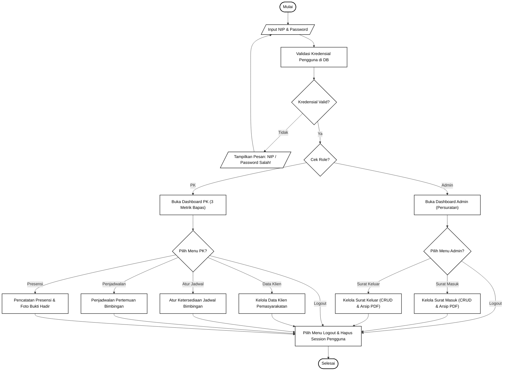
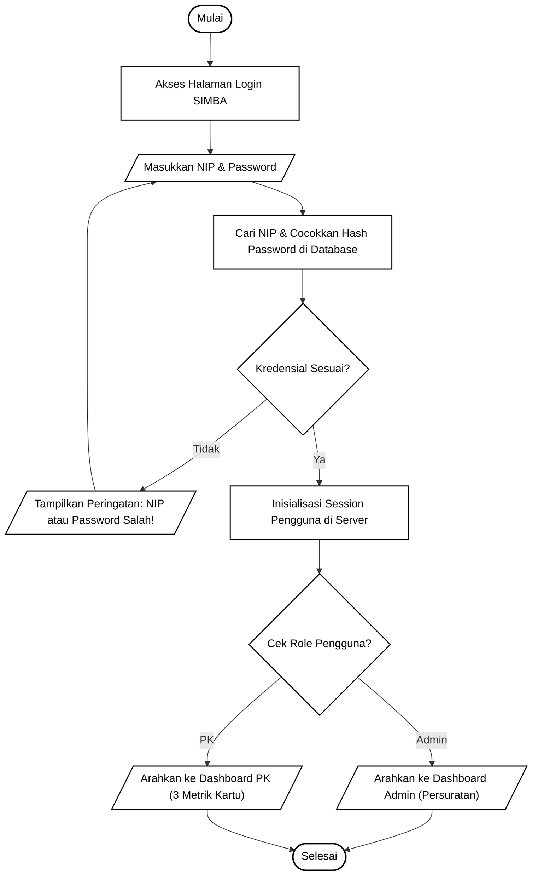
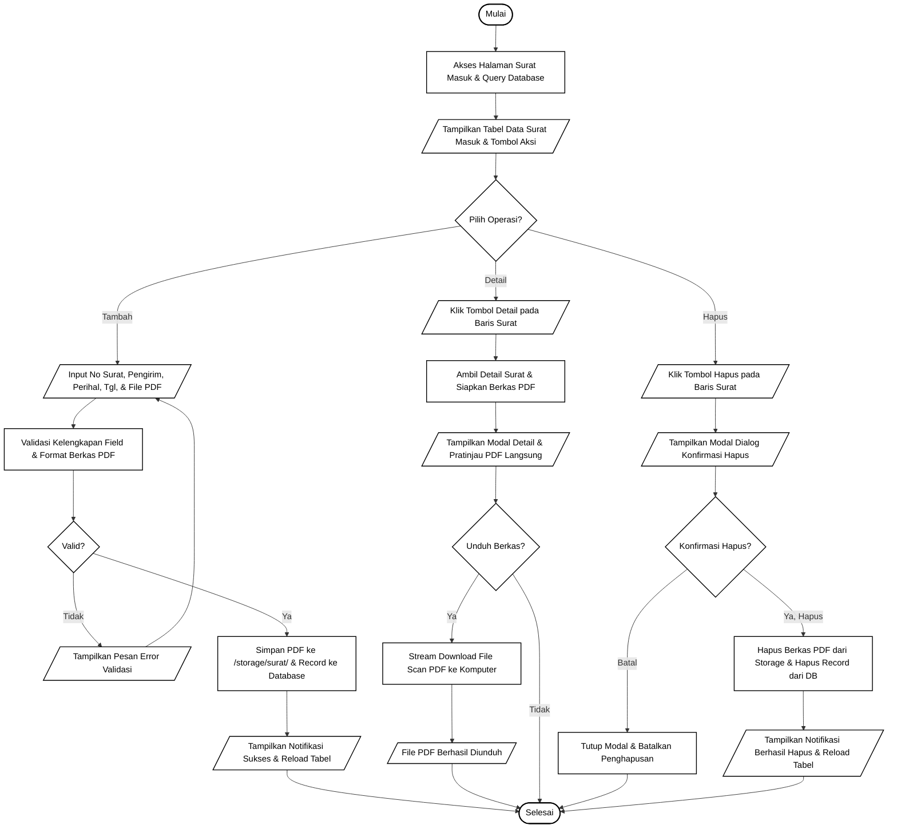
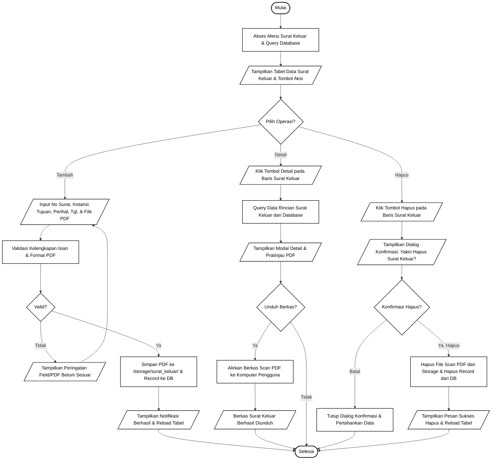
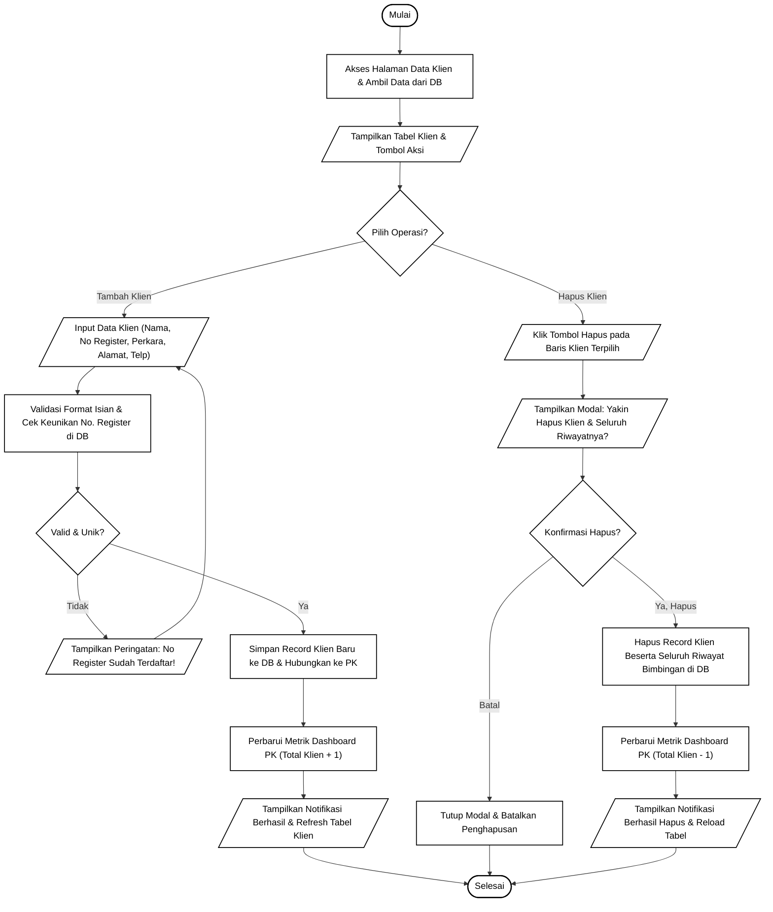
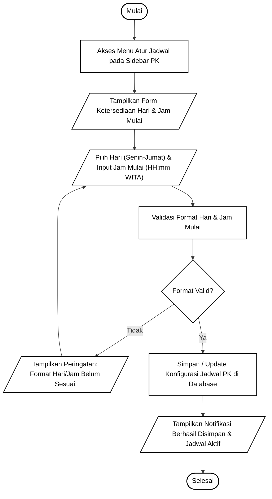
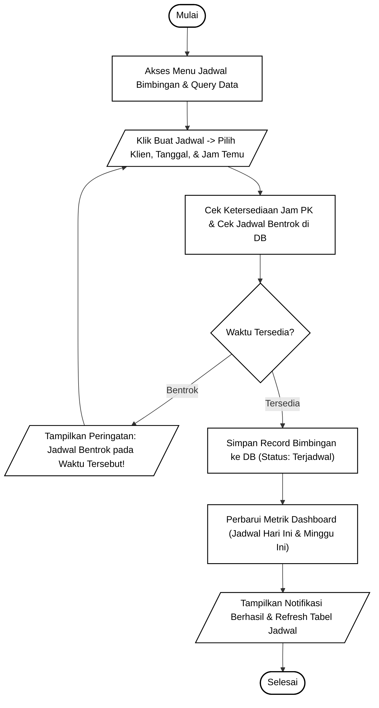
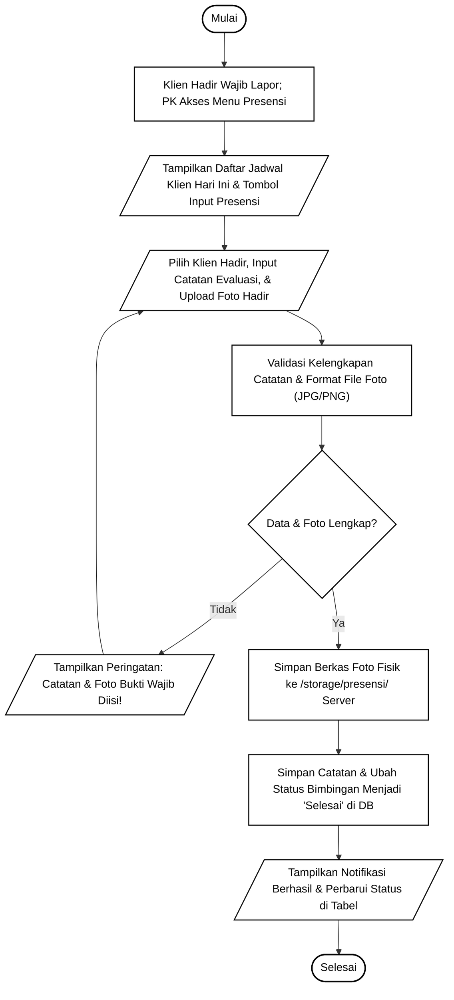

# Spesifikasi & Flowchart Sistem SIMBA (Hitam Putih Murni Sesuai Standar ANSI/ISO)
**Balai Pemasyarakatan (Bapas) Kelas I Banjarmasin**

> [!NOTE]
> Flowchart sistem ini dirancang mengikuti kaidah baku simbol bagan alir (ANSI/ISO Flowchart) sesuai contoh referensi yang diberikan:
> - **Terminator (Oval / Kapsul)**: `Mulai` dan `Selesai`.
> - **Input / Output (Jajar Genjang / Parallelogram)**: Operasi masukan data oleh pengguna atau luaran tampilan dari sistem.
> - **Process (Persegi Panjang)**: Proses pemrosesan data, validasi, komputasi, atau manipulasi basis data.
> - **Decision (Belah Ketupat / Rhombus)**: Titik evaluasi kondisi percabangan logika (*Ya* / *Tidak* / *Pilihan Role/Menu*).
> - **Gaya Tampilan**: **100% Hitam Putih (Black & White)** rapi, simetris, dan bebas tabrakan garis (*zero line collision*).

Berkas diagram siap buka dan langsung dapat diedit di Draw.io tersedia pada:
- [`c:\laragon\www\SIMBA\diagram\flowchart_simba.drawio`](file:///c:/laragon/www/SIMBA/diagram/flowchart_simba.drawio)

---

## Daftar Lembar Kerja (8 Sheet Tabs pada Draw.io)

| No | Tab Name di Draw.io | Deskripsi Alur Program |
|---|---|---|
| 1 | `1. Flowchart Utama Sistem` | Alur menyeluruh (*Macro / Overview*) dari Login, percabangan Role (Admin vs PK), navigasi menu utama, hingga Logout. |
| 2 | `2. Flowchart Login Sistem` | Logika autentikasi NIP & password, pencocokan hash DB, penanganan salah sandi, dan pembentukan sesi. |
| 3 | `3. Flowchart Surat Masuk` | Pengelolaan lengkap surat masuk: Tambah & upload berkas PDF, Lihat Detail & Preview PDF, serta Hapus berkas & data DB. |
| 4 | `4. Flowchart Surat Keluar` | Pengelolaan lengkap surat keluar: Tambah & upload berkas PDF, Lihat Detail & Preview PDF, serta Hapus berkas & data DB. |
| 5 | `5. Flowchart Data Klien` | Registrasi klien *(tanpa jenis bimbingan)*, validasi keunikan No Register Bapas, update metrik Total Klien (+1/-1), dan Hapus Klien. |
| 6 | `6. Flowchart Atur Jadwal (PK)` | Pengaturan ketersediaan hari bimbingan & jam mulai *(tanpa kuota dan tanpa jam selesai)*. |
| 7 | `7. Flowchart Penjadwalan Bimbingan` | Pembuatan janji temu bimbingan tatap muka, pengecekan bentrok jadwal, dan pembaruan counter metrik dashboard PK. |
| 8 | `8. Flowchart Presensi & Bukti Hadir` | Verifikasi wajib lapor fisik, upload berkas foto presensi ke storage, input evaluasi, dan otomasi status bimbingan menjadi "Selesai". |

---

## 1. Flowchart Sistem Utama (Macro / Overview SIMBA)

Menggambarkan alur logika global sistem dari pengguna mengakses SIMBA, melakukan autentikasi, bercabang sesuai hak akses (*Role Admin* atau *Role PK*), mengeksekusi modul-modul fungsional, hingga mengakhiri sesi (*Logout*):

---

## 2. Flowchart Login Sistem & Hak Akses

Diagram alir program rinci untuk proses verifikasi identitas pengguna menggunakan NIP (Nomor Induk Pegawai) sebagai username:

---

## 3. Flowchart Pengelolaan Surat Masuk (Admin / Bagian Umum)

Diagram alir untuk seluruh siklus hidup arsip surat kedinasan masuk, meliputi penambahan berkas PDF baru, peninjauan detail & unduh dokumen, serta penghapusan fisik berkas dari server:

---

## 4. Flowchart Pengelolaan Surat Keluar (Admin / Bagian Umum)

Diagram alir untuk pengelolaan surat dinas bapas yang ditujukan ke instansi luar:

---

## 5. Flowchart Pengelolaan Data Klien Pemasyarakatan (PK)

Diagram alir untuk penambahan dan penghapusan klien bapas *(tanpa jenis bimbingan)* serta sinkronisasi metrik `Total Klien` pada Dashboard PK:

---

## 6. Flowchart Pengaturan Ketersediaan Jadwal Bimbingan (PK)

Diagram alir penentuan hari dan jam mulai bimbingan oleh PK *(tanpa kuota dan tanpa jam selesai)*:

---

## 7. Flowchart Penjadwalan Pertemuan Bimbingan Klien (PK)

Diagram alir pembuatan jadwal sesi bimbingan tatap muka dengan deteksi bentrok jadwal dan pembaruan counter metrik dashboard:

---

## 8. Flowchart Pencatatan Presensi & Bukti Kehadiran Klien (PK)

Diagram alir pelaksanaan wajib lapor klien, evaluasi bimbingan, upload bukti foto kehadiran fisik, dan pembaruan status menjadi "Selesai":

---

## Ringkasan Standar Simbol Flowchart yang Digunakan

| Simbol Flowchart | Nama Simbol | Fungsi dalam Sistem SIMBA |
|---|---|---|
| Kapsul / Oval | **Terminator** | Menandai awal (*Mulai*) dan akhir (*Selesai*) dari suatu alur sistem atau prosedur. |
| Jajar Genjang (*Parallelogram*) | **Input / Output** | Masukan dari pengguna (misal: input NIP, input formulir surat/klien, unggah berkas PDF/foto) serta keluaran sistem (misal: pesan sukses, pesan kesalahan, unduhan berkas). |
| Persegi Panjang (*Rectangle*) | **Process** | Eksekusi logika internal komputer (misal: validasi field, pencocokan hash password, operasi simpan/hapus di database, pembaruan metrik dashboard). |
| Belah Ketupat (*Rhombus / Diamond*) | **Decision** | Penentu cabang keputusan berbasis kondisi boolean (misal: *Kredensial Valid?*, *Konfirmasi Hapus?*, *Jadwal Bentrok?*). |
| Garis Panah (*Directed Flowline*) | **Flowline** | Aliran urutan instruksi program yang berjalan secara orthogonal teratur dari atas ke bawah (*top-down*). |
