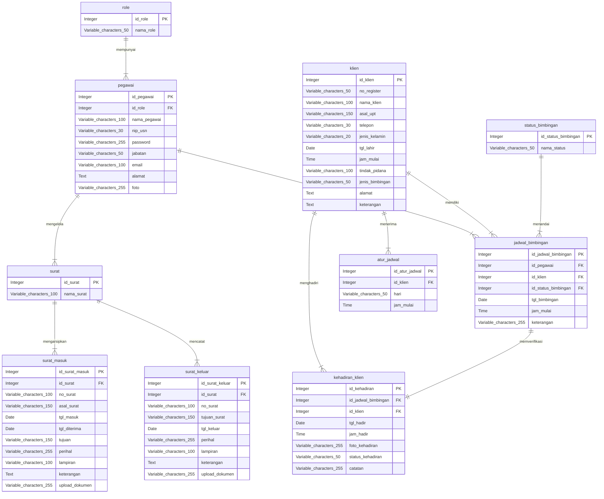

# Spesifikasi Logical Data Model (LDM) Sistem Informasi SIMBA
**Balai Pemasyarakatan (Bapas) Kelas I Banjarmasin**

> [!NOTE]
> Diagram LDM (*Logical Data Model*) ini merupakan turunan langsung dari **CDM Mutakhir SIMBA** yang telah disesuaikan dengan standar visual **PowerDesigner LDM (Format Cyan `#E5FFFF` / `#00AAAA`)** dengan **Tata Letak Bebas Tabrakan (*Zero Line Collision*)**:
> 1. **Struktur Entitas Logikal 3 Kompartemen**:
>    - **Baris Judul (*Entity Name*)**: Berisi nama entitas berlatar cyan (`#E5FFFF`) dengan border `#00AAAA`.
>    - **Daftar Atribut Logikal (*Attributes*)**: Berisi nama atribut, tipe data logikal PowerDesigner (`Integer`, `Variable characters (n)`, `Date`, `Time`, `Text`), serta penanda `<pi>` (*Primary Identifier*) dan `<fi>` (*Foreign Identifier*).
>    - **Baris Identifier Primer (*Primary Identifier*)**: Berisi label penanda kunci identitas primer: `identifier_1   <pi>` di baris paling bawah.
> 2. **Pencantuman Foreign Identifier (`<fi>`)**:
>    - Berbeda dengan CDM, pada LDM relasi konseptual telah ditransformasikan menjadi atribut kunci asing (*Foreign Identifier*) yang ditandai dengan label `<fi>`.
> 3. **Notasi Kardinalitas Relasi PowerDesigner LDM**:
>    - Tanda garis tegak lurus `|` (*Mandatory One / ERone*): Kardinalitas tepat satu (1,1).
>    - Tanda cakar gagak bergaris `>-|` (*Mandatory Many / ERoneToMany*): Kardinalitas satu ke banyak (1,n).
>    - Setiap garis memuat predikat relasi dan mengalir rapi tanpa ada garis yang saling memotong (*zero crossing*).

---

## Berkas Diagram yang Tersedia

Diagram LDM tersimpan pada direktori [`diagram/`](file:///c:/laragon/www/SIMBA/diagram):

| No | Nama Berkas | Tipe Berkas | Deskripsi & Lokasi Akses |
|---|---|---|---|
| 1 | **[`ldm_simba.drawio`](file:///c:/laragon/www/SIMBA/diagram/ldm_simba.drawio)** | Standalone Draw.io | Berkas mandiri Draw.io khusus LDM SIMBA untuk dibuka & diedit langsung di VS Code. |
| 2 | **[`ldm_simba.svg`](file:///c:/laragon/www/SIMBA/diagram/ldm_simba.svg)** | Vektor SVG Standar | Gambar vektor resolusi tinggi siap pratinjau langsung di peramban web maupun laporan dokumen. |
| 3 | **[`ldm_simba.png`](file:///c:/laragon/www/SIMBA/diagram/ldm_simba.png)** | Raster PNG | Berkas gambar PNG resolusi tinggi siap disematkan ke dalam laporan/skripsi. |

---

## 1. Visualisasi Mermaid LDM SIMBA

---

## 2. Kamus Data Logikal (LDM)

| Entitas | Atribut Logikal, Tipe Data & Penanda Identifier | Identifier Primer | Keterangan Pemetaan Logikal |
|---|---|---|---|
| **`role`** | `<u>id_role</u> : Integer <pi>`, `nama_role : Variable characters (50)` | `identifier_1 <pi>` | Master hak akses peran pengguna. |
| **`pegawai`** | `<u>id_pegawai</u> : Integer <pi>`, `id_role : Integer <fi>`, `nama_pegawai : Variable characters (100)`, `nip_usn : Variable characters (30)`, `password : Variable characters (255)`, `jabatan : Variable characters (50)`, `email : Variable characters (100)`, `alamat : Text`, `foto : Variable characters (255)` | `identifier_1 <pi>` | Memiliki foreign identifier `id_role`. |
| **`surat`** | `<u>id_surat</u> : Integer <pi>`, `nama_surat : Variable characters (100)` | `identifier_1 <pi>` | Master klasifikasi surat dinas. |
| **`surat_masuk`** | `<u>id_surat_masuk</u> : Integer <pi>`, `id_surat : Integer <fi>`, `no_surat : Variable characters (100)`, `asal_surat : Variable characters (150)`, `tgl_masuk : Date`, `tgl_diterima : Date`, `tujuan : Variable characters (150)`, `perihal : Variable characters (255)`, `lampiran : Variable characters (100)`, `keterangan : Text`, `upload_dokumen : Variable characters (255)` | `identifier_1 <pi>` | Foreign identifier `id_surat` merujuk ke tabel `surat`. |
| **`surat_keluar`** | `<u>id_surat_keluar</u> : Integer <pi>`, `id_surat : Integer <fi>`, `no_surat : Variable characters (100)`, `tujuan_surat : Variable characters (150)`, `tgl_keluar : Date`, `perihal : Variable characters (255)`, `lampiran : Variable characters (100)`, `keterangan : Text`, `upload_dokumen : Variable characters (255)` | `identifier_1 <pi>` | Foreign identifier `id_surat` merujuk ke tabel `surat`. |
| **`klien`** | `<u>id_klien</u> : Integer <pi>`, `no_register : Variable characters (50)`, `nama_klien : Variable characters (100)`, `asal_upt : Variable characters (150)`, `telepon : Variable characters (30)`, `jenis_kelamin : Variable characters (20)`, `tgl_lahir : Date`, `jam_mulai : Time`, `tindak_pidana : Variable characters (100)`, `jenis_bimbingan : Variable characters (50)`, `alamat : Text`, `keterangan : Text` | `identifier_1 <pi>` | Master data klien pemasyarakatan lengkap 12 atribut. |
| **`atur_jadwal`** | `<u>id_atur_jadwal</u> : Integer <pi>`, `id_klien : Integer <fi>`, `hari : Variable characters (50)`, `jam_mulai : Time` | `identifier_1 <pi>` | Foreign identifier `id_klien` merujuk ke tabel `klien`. |
| **`status_bimbingan`** | `<u>id_status_bimbingan</u> : Integer <pi>`, `nama_status : Variable characters (50)` | `identifier_1 <pi>` | Master status perkembangan bimbingan. |
| **`jadwal_bimbingan`** | `<u>id_jadwal_bimbingan</u> : Integer <pi>`, `id_pegawai : Integer <fi>`, `id_klien : Integer <fi>`, `id_status_bimbingan : Integer <fi>`, `tgl_bimbingan : Date`, `jam_mulai : Time`, `keterangan : Variable characters (255)` | `identifier_1 <pi>` | Tiga foreign identifier: `id_pegawai`, `id_klien`, dan `id_status_bimbingan`. |
| **`kehadiran_klien`** | `<u>id_kehadiran</u> : Integer <pi>`, `id_jadwal_bimbingan : Integer <fi>`, `id_klien : Integer <fi>`, `tgl_hadir : Date`, `jam_hadir : Time`, `foto_kehadiran : Variable characters (255)`, `status_kehadiran : Variable characters (50)`, `catatan : Variable characters (255)` | `identifier_1 <pi>` | Dua foreign identifier: `id_jadwal_bimbingan` dan `id_klien`. |

---

## 3. Matriks Kardinalitas Relasi PowerDesigner LDM

| No | Relasi | Dari Entitas | Kardinalitas | Ke Entitas | Simbol Start | Simbol End | Foreign Identifier yang Dihasilkan |
|---|---|---|---|---|---|---|---|
| 1 | `mempunyai` | `role` | $1 : N$ | `pegawai` | `|` | `>-|` | `pegawai.id_role` |
| 2 | `mengelola` | `pegawai` | $1 : N$ | `surat` | `|` | `>-|` | Relasi tata kelola surat |
| 3 | `mengarsipkan` | `surat` | $1 : N$ | `surat_masuk` | `|` | `>-|` | `surat_masuk.id_surat` |
| 4 | `mencatat` | `surat` | $1 : N$ | `surat_keluar` | `|` | `>-|` | `surat_keluar.id_surat` |
| 5 | `menjadwalkan` | `pegawai` | $1 : N$ | `jadwal_bimbingan` | `|` | `>-|` | `jadwal_bimbingan.id_pegawai` |
| 6 | `menandai` | `status_bimbingan` | $1 : N$ | `jadwal_bimbingan` | `|` | `>-|` | `jadwal_bimbingan.id_status_bimbingan` |
| 7 | `menerima` | `klien` | $1 : N$ | `atur_jadwal` | `|` | `>-|` | `atur_jadwal.id_klien` |
| 8 | `memiliki` | `klien` | $1 : N$ | `jadwal_bimbingan` | `|` | `>-|` | `jadwal_bimbingan.id_klien` |
| 9 | `menghadiri` | `klien` | $1 : N$ | `kehadiran_klien` | `|` | `>-|` | `kehadiran_klien.id_klien` |
| 10 | `memverifikasi` | `jadwal_bimbingan` | $1 : 1$ | `kehadiran_klien` | `|` | `|` | `kehadiran_klien.id_jadwal_bimbingan` |
