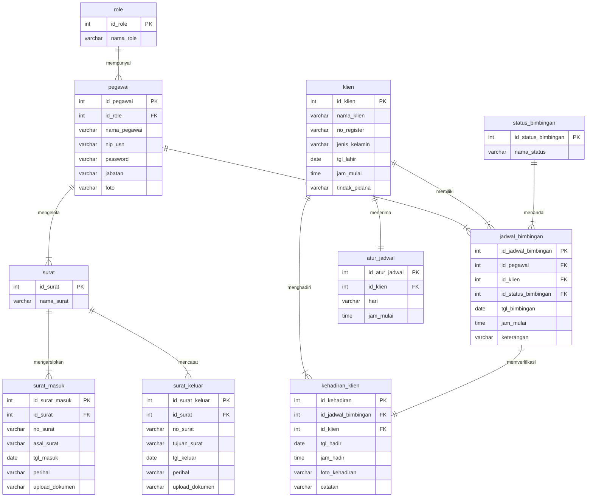

# Spesifikasi Logical Data Model (LDM) Sistem Informasi SIMBA
**Balai Pemasyarakatan (Bapas) Kelas I Banjarmasin**

> [!NOTE]
> Diagram LDM (*Logical Data Model*) ini dibangun berdasarkan **ERD Fiks SIMBA** dan mengikuti standar visual **PowerDesigner LDM (Format Biru Muda/Cyan)** persis sesuai contoh referensi yang dilampirkan:
> 1. **Format Tabel 4 Kolom (*Entity Attributes Table*)**:
>    - **Kolom 1 (*Field Name*)**: Nama kolom/atribut dengan *Primary Identifier* bergaris bawah (`<u>nama_id</u>`).
>    - **Kolom 2 (*Identifier Tag*)**: Penanda peran identitas: `<pi>` untuk *Primary Identifier* dan `<fi>` / `<fi1..3>` untuk *Foreign Identifier* (migrasi *Foreign Key* dari relasi).
>    - **Kolom 3 (*Data Type*)**: Tipe data logikal standar DBMS (misal: `Integer`, `Variable characters (20..255)`, `Date`, `Time`).
>    - **Kolom 4 (*Mandatory Flag*)**: Penanda keharusan nilai `<M>` (*Mandatory* / *Not Null*).
> 2. **Migrasi Foreign Key (FK) dari Relasi CDM ke LDM**:
>    - Berbeda dengan CDM yang tidak memuat kolom FK, pada LDM setiap relasi satu ke banyak ($1 \rightarrow N$) mentransformasikan *Primary Identifier* dari entitas induk (*One side*) menjadi kolom *Foreign Identifier* bertanda `<fi>` pada entitas anak (*Many side*).
>    - Contoh: `id_role <fi>` pada `pegawai`, `id_klien <fi>` pada `atur_jadwal`, serta `id_pegawai <fi1>`, `id_klien <fi2>`, dan `id_status_bimbingan <fi3>` pada `jadwal_bimbingan`.
> 3. **Notasi Kardinalitas Relasi PowerDesigner**:
>    - Tanda garis tegak lurus `|` (*Mandatory One / ERone*): Kardinalitas tepat satu (1).
>    - Tanda cakar gagak bergaris `>-|` (*Mandatory Many / ERoneToMany*): Kardinalitas satu ke banyak ($1..n$).
>    - Kata kerja predikat relasi tertera tepat di tengah garis relasi.

---

## Berkas Diagram yang Tersedia

Diagram LDM telah diintegrasikan langsung ke dalam repositori lokal SIMBA pada direktori [`diagram/`](file:///c:/laragon/www/SIMBA/diagram):

| No | Nama Berkas | Tipe Berkas | Deskripsi & Lokasi Akses |
|---|---|---|---|
| 1 | **[`erd_baru.drawio`](file:///c:/laragon/www/SIMBA/diagram/erd_baru.drawio)** | Multi-Sheet Draw.io | Tab sheet **`LDM`** telah diisi lengkap dengan 10 entitas & 10 relasi logikal. |
| 2 | **[`ldm_simba.drawio`](file:///c:/laragon/www/SIMBA/diagram/ldm_simba.drawio)** | Standalone Draw.io | Berkas Draw.io khusus LDM mandiri untuk dibuka & diedit langsung di VS Code. |
| 3 | **[`ldm_simba.svg`](file:///c:/laragon/www/SIMBA/diagram/ldm_simba.svg)** | Vektor SVG Standar | Gambar vektor resolusi tinggi siap pratinjau langsung di peramban web maupun laporan dokumen. |

---

## 1. Visualisasi Mermaid LDM SIMBA

Diagram hubungan logikal antar entitas SIMBA dengan seluruh foreign key dan tipe data logikal:



---

## 2. Kamus Data Logikal Entitas (*Logical Entity Dictionary*)

Berikut spesifikasi 10 entitas pada LDM SIMBA beserta struktur kolom, tipe data, peran *identifier*, dan status *mandatory*:

### 1. Entitas `role`
| Field Name | Identifier Tag | Data Type | Mandatory | Keterangan |
|---|:---:|---|:---:|---|
| `id_role` | `<pi>` | `Integer` | `<M>` | Primary Identifier unik role pengguna |
| `nama_role` | | `Variable characters (50)` | `<M>` | Nama peran (Admin / PK) |

### 2. Entitas `pegawai`
| Field Name | Identifier Tag | Data Type | Mandatory | Keterangan |
|---|:---:|---|:---:|---|
| `id_pegawai` | `<pi>` | `Integer` | `<M>` | Primary Identifier unik pegawai |
| `id_role` | `<fi>` | `Integer` | `<M>` | Foreign Identifier dari entitas `role` |
| `nama_pegawai` | | `Variable characters (100)` | `<M>` | Nama lengkap aparatur pegawai |
| `nip(usn)` | | `Variable characters (30)` | `<M>` | Nomor Induk Pegawai / Username login |
| `password` | | `Variable characters (64)` | `<M>` | Hash kata sandi akun |
| `jabatan` | | `Variable characters (50)` | `<M>` | Jabatan dinas di Bapas Banjarmasin |
| `foto` | | `Variable characters (255)` | `<M>` | Lokasi file foto profil |

### 3. Entitas `surat`
| Field Name | Identifier Tag | Data Type | Mandatory | Keterangan |
|---|:---:|---|:---:|---|
| `id_surat` | `<pi>` | `Integer` | `<M>` | Primary Identifier kelompok arsip surat |
| `nama_surat` | | `Variable characters (100)` | `<M>` | Klasifikasi surat dinas |

### 4. Entitas `surat_masuk`
| Field Name | Identifier Tag | Data Type | Mandatory | Keterangan |
|---|:---:|---|:---:|---|
| `id_surat_masuk` | `<pi>` | `Integer` | `<M>` | Primary Identifier arsip surat masuk |
| `id_surat` | `<fi>` | `Integer` | `<M>` | Foreign Identifier dari entitas `surat` |
| `no_surat` | | `Variable characters (50)` | `<M>` | Nomor registrasi surat masuk |
| `asal_surat` | | `Variable characters (100)` | `<M>` | Instansi asal pengirim surat |
| `tgl_masuk` | | `Date` | `<M>` | Tanggal surat diterima di Bapas |
| `perihal` | | `Variable characters (255)` | `<M>` | Pokok isi perihal surat masuk |
| `upload_dokumen` | | `Variable characters (255)` | `<M>` | Path/nama berkas pindaian dokumen |

### 5. Entitas `surat_keluar`
| Field Name | Identifier Tag | Data Type | Mandatory | Keterangan |
|---|:---:|---|:---:|---|
| `id_surat_keluar` | `<pi>` | `Integer` | `<M>` | Primary Identifier arsip surat keluar |
| `id_surat` | `<fi>` | `Integer` | `<M>` | Foreign Identifier dari entitas `surat` |
| `no_surat` | | `Variable characters (50)` | `<M>` | Nomor surat dinas yang diterbitkan |
| `tujuan_surat` | | `Variable characters (100)` | `<M>` | Lembaga/pihak tujuan pengiriman |
| `tgl_keluar` | | `Date` | `<M>` | Tanggal surat diterbitkan |
| `perihal` | | `Variable characters (255)` | `<M>` | Pokok isi perihal surat keluar |
| `upload_dokumen` | | `Variable characters (255)` | `<M>` | Path/nama berkas dokumen terbitan |

### 6. Entitas `klien`
| Field Name | Identifier Tag | Data Type | Mandatory | Keterangan |
|---|:---:|---|:---:|---|
| `id_klien` | `<pi>` | `Integer` | `<M>` | Primary Identifier unik klien binaan |
| `nama_klien` | | `Variable characters (100)` | `<M>` | Nama lengkap warga binaan |
| `no_register` | | `Variable characters (50)` | `<M>` | Nomor registrasi integrasi Bapas |
| `jenis_kelamin` | | `Variable characters (20)` | `<M>` | Laki-laki / Perempuan |
| `tgl_lahir` | | `Date` | `<M>` | Tanggal lahir klien binaan |
| `jam_mulai` | | `Time` | `<M>` | Waktu standar wajib lapor |
| `tindak_pidana` | | `Variable characters (100)` | `<M>` | Perkara tindak pidana asal |

### 7. Entitas `atur_jadwal`
| Field Name | Identifier Tag | Data Type | Mandatory | Keterangan |
|---|:---:|---|:---:|---|
| `id_atur_jadwal` | `<pi>` | `Integer` | `<M>` | Primary Identifier jadwal berkala |
| `id_klien` | `<fi>` | `Integer` | `<M>` | Foreign Identifier dari entitas `klien` |
| `hari` | | `Variable characters (20)` | `<M>` | Hari wajib lapor mingguan/bulanan |
| `jam_mulai` | | `Time` | `<M>` | Waktu pelaksanaan wajib lapor |

### 8. Entitas `status_bimbingan`
| Field Name | Identifier Tag | Data Type | Mandatory | Keterangan |
|---|:---:|---|:---:|---|
| `id_status_bimbingan` | `<pi>` | `Integer` | `<M>` | Primary Identifier status bimbingan |
| `nama_status` | | `Variable characters (50)` | `<M>` | Status (Menunggu / Selesai / Absen) |

### 9. Entitas `jadwal_bimbingan`
| Field Name | Identifier Tag | Data Type | Mandatory | Keterangan |
|---|:---:|---|:---:|---|
| `id_jadwal_bimbingan` | `<pi>` | `Integer` | `<M>` | Primary Identifier sesi bimbingan |
| `id_pegawai` | `<fi1>` | `Integer` | `<M>` | Foreign Identifier Pembimbing (PK) |
| `id_klien` | `<fi2>` | `Integer` | `<M>` | Foreign Identifier Klien Binaan |
| `id_status_bimbingan` | `<fi3>` | `Integer` | `<M>` | Foreign Identifier Status Pelaksanaan |
| `tgl_bimbingan` | | `Date` | `<M>` | Tanggal pelaksanaan bimbingan |
| `jam_mulai` | | `Time` | `<M>` | Jam sesi bimbingan dimulai |
| `keterangan` | | `Variable characters (255)` | `<M>` | Materi/catatan bimbingan kepribadian/kemandirian |

### 10. Entitas `kehadiran_klien`
| Field Name | Identifier Tag | Data Type | Mandatory | Keterangan |
|---|:---:|---|:---:|---|
| `id_kehadiran` | `<pi>` | `Integer` | `<M>` | Primary Identifier rekaman presensi |
| `id_jadwal_bimbingan` | `<fi1>` | `Integer` | `<M>` | Foreign Identifier Sesi Jadwal Terkait |
| `id_klien` | `<fi2>` | `Integer` | `<M>` | Foreign Identifier Klien yang Hadir |
| `tgl_hadir` | | `Date` | `<M>` | Tanggal fisik kedatangan wajib lapor |
| `jam_hadir` | | `Time` | `<M>` | Jam presensi tercatat di sistem |
| `foto_kehadiran` | | `Variable characters (255)` | `<M>` | Bukti foto kehadiran fisik di Bapas |
| `catatan` | | `Variable characters (255)` | `<M>` | Catatan evaluasi PK atas kehadiran |

---

## 3. Matriks Relasi Antar Entitas (*Relationship Matrix*)

| No | Entitas Asal | Relasi | Entitas Tujuan | Kardinalitas LDM | Migrasi Kolom FK yang Dihasilkan |
|:--:|---|:---:|---|:---:|---|
| 1 | `role` | **mempunyai** | `pegawai` | $1 \rightarrow N$ (`\|` ke `>-|`) | Menghasilkan `id_role <fi>` pada entitas `pegawai`. |
| 2 | `pegawai` | **mengelola** | `surat` | $1 \rightarrow N$ (`\|` ke `>-|`) | Menghubungkan pegawai pengelola dengan kategori persuratan dinas. |
| 3 | `surat` | **mengarsipkan** | `surat_masuk` | $1 \rightarrow N$ (`\|` ke `>-|`) | Menghasilkan `id_surat <fi>` pada entitas `surat_masuk`. |
| 4 | `surat` | **mencatat** | `surat_keluar` | $1 \rightarrow N$ (`\|` ke `>-|`) | Menghasilkan `id_surat <fi>` pada entitas `surat_keluar`. |
| 5 | `pegawai` | **menjadwalkan** | `jadwal_bimbingan` | $1 \rightarrow N$ (`\|` ke `>-|`) | Menghasilkan `id_pegawai <fi1>` pada entitas `jadwal_bimbingan`. |
| 6 | `atur_jadwal` | **menerima** | `klien` | $1 \rightarrow 1$ (`\|` ke `\|`) | Menghasilkan `id_klien <fi>` pada entitas `atur_jadwal`. |
| 7 | `klien` | **memiliki** | `jadwal_bimbingan` | $1 \rightarrow N$ (`\|` ke `>-|`) | Menghasilkan `id_klien <fi2>` pada entitas `jadwal_bimbingan`. |
| 8 | `status_bimbingan` | **menandai** | `jadwal_bimbingan` | $1 \rightarrow N$ (`\|` ke `>-|`) | Menghasilkan `id_status_bimbingan <fi3>` pada `jadwal_bimbingan`. |
| 9 | `jadwal_bimbingan` | **memverifikasi** | `kehadiran_klien` | $1 \rightarrow 1$ (`\|` ke `\|`) | Menghasilkan `id_jadwal_bimbingan <fi1>` pada `kehadiran_klien`. |
| 10 | `klien` | **menghadiri** | `kehadiran_klien` | $1 \rightarrow N$ (`\|` ke `>-|`) | Menghasilkan `id_klien <fi2>` pada `kehadiran_klien`. |

---

## 4. Perbandingan Konseptual (CDM) vs Logikal (LDM)

| Aspek Model | CDM (*Conceptual Data Model*) | LDM (*Logical Data Model*) |
|---|---|---|
| **Tujuan** | Memetakan konsep data bisnis murni Bapas Banjarmasin | Memetakan struktur relasional logikal lengkap sebelum fisik DBMS |
| **Foreign Key (FK)** | **Ditiadakan** pada daftar atribut (hanya garis relasi) | **Hadir lengkap** sebagai atribut bertanda `<fi>` atau `<fi1..3>` |
| **Tipe Data** | Bersifat opsional / konseptual tingkat tinggi | Spesifik logikal (`Integer`, `Variable characters (n)`, `Date`, `Time`) |
| **Batasan Null** | Belum didefinisikan secara tegas | Ditegaskan dengan bendera `<M>` (*Mandatory*) |
| **Kesiapan DDL** | Belum dapat langsung di-*generate* menjadi SQL DDL | Siap ditransformasikan langsung menjadi PDM & tabel MySQL/PostgreSQL |

---

## 5. Panduan Membuka & Mengedit di VS Code / Git CLI

### Membuka di VS Code
Karena ekstensi Draw.io (`hediet.vscode-drawio`) telah terpasang di VS Code Anda:
1. Klik berkas [`diagram/ldm_simba.drawio`](file:///c:/laragon/www/SIMBA/diagram/ldm_simba.drawio) atau [`diagram/erd_baru.drawio`](file:///c:/laragon/www/SIMBA/diagram/erd_baru.drawio) pada *Explorer* VS Code.
2. Pada `erd_baru.drawio`, klik *tab sheet* bertuliskan **`LDM`** di bagian bawah kanvas editor.

### Perintah Melalui Git / GitHub CLI di Komputer Anda
Untuk menambahkan dan melakukan *commit* perubahan diagram LDM ini ke repositori Git SIMBA:

```bash
# Cek status berkas diagram
git status

# Tambahkan perubahan berkas diagram LDM ke staging area
git add diagram/erd_baru.drawio diagram/ldm_simba.drawio diagram/ldm_simba.svg diagram/ldm_simba.md

# Lakukan commit dengan pesan deskriptif
git commit -m "feat(diagram): implementasi LDM SIMBA berbasis ERD fiks dengan notasi PowerDesigner LDM"

# Push ke repositori GitHub (jika diinginkan)
git push origin main
```
