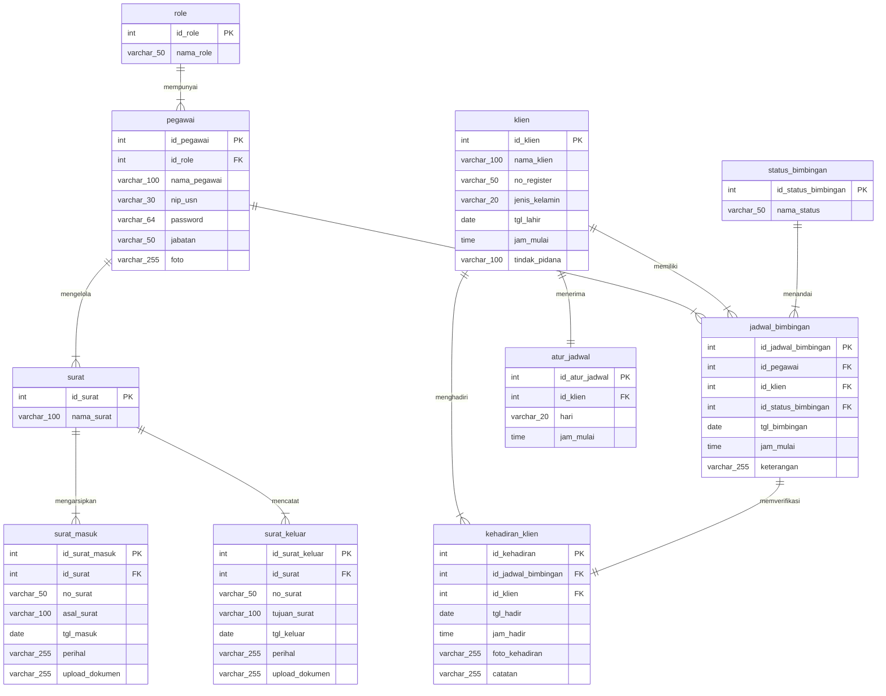

# Spesifikasi Physical Data Model (PDM) Sistem Informasi SIMBA
**Balai Pemasyarakatan (Bapas) Kelas I Banjarmasin**

> [!NOTE]
> Diagram PDM (*Physical Data Model*) ini dibangun berdasarkan **ERD Fiks SIMBA** dan mengikuti standar visual **PowerDesigner PDM (Format Biru Muda/Cyan)** persis sesuai contoh referensi yang dilampirkan:
> 1. **Struktur Tabel 2 Kompartemen (Tanpa Footer `<pi>`)**:
>    - Berbeda dengan CDM dan LDM yang memiliki kompartemen bawah `identifier_1  <pi>`, pada standar PDM PowerDesigner **tidak terdapat kompartemen bawah**, karena seluruh batasan integritas primer dan relasional telah dipetakan secara fisik ke dalam kolom dan indeks.
>    - **Kompartemen Atas**: Nama tabel basis data (*centered*, teks tebal) berlatar *pale cyan* (`#E5FFFF`) dengan bingkai *cyan* (`#00AAAA`).
>    - **Kompartemen Bawah (Daftar Kolom Fisik)**: Menampilkan 4 kolom spesifikasi fisik tabel.
> 2. **Format Kolom Fisik PDM 4 Kolom**:
>    - **Kolom 1 (*Column Name*)**: Nama kolom basis data dengan *Primary Key* bergaris bawah (`<u>nama_kolom</u>`).
>    - **Kolom 2 (*Physical Data Type*)**: Tipe data fisik SQL/DBMS aktual (`int`, `varchar(n)`, `date`, `time`).
>    - **Kolom 3 (*Constraint Key Tag*)**: Penanda batasan kunci fisik: `<pk>` untuk *Primary Key* dan `<fk>` / `<fk1..3>` untuk *Foreign Key*.
>    - **Kolom 4 (*Index Tag*)**: Penanda indeks fisik: `<i>` atau `<i1..4>` untuk pengindeksan kunci primer dan kunci asing di tingkat basis data.
> 3. **Notasi Kardinalitas Relasi PowerDesigner**:
>    - Tanda garis tegak lurus `|` (*Mandatory One / ERone*): Kardinalitas tepat satu (1).
>    - Tanda cakar gagak bergaris `>-|` (*Mandatory Many / ERoneToMany*): Kardinalitas satu ke banyak ($1..n$).
>    - Kata kerja predikat relasi tertera tepat di tengah garis relasi.

---

## Berkas Diagram yang Tersedia

Diagram PDM telah diintegrasikan langsung ke dalam repositori lokal SIMBA pada direktori [`diagram/`](file:///c:/laragon/www/SIMBA/diagram):

| No | Nama Berkas | Tipe Berkas | Deskripsi & Lokasi Akses |
|---|---|---|---|
| 1 | **[`erd_baru.drawio`](file:///c:/laragon/www/SIMBA/diagram/erd_baru.drawio)** | Multi-Sheet Draw.io | Tab sheet **`PDM`** telah diisi lengkap dengan 10 tabel fisik & 10 relasi fisik. |
| 2 | **[`pdm_simba.drawio`](file:///c:/laragon/www/SIMBA/diagram/pdm_simba.drawio)** | Standalone Draw.io | Berkas Draw.io khusus PDM mandiri untuk dibuka & diedit langsung di VS Code. |
| 3 | **[`pdm_simba.svg`](file:///c:/laragon/www/SIMBA/diagram/pdm_simba.svg)** | Vektor SVG Standar | Gambar vektor resolusi tinggi siap pratinjau langsung di peramban web maupun laporan dokumen. |

---

## 1. Visualisasi Mermaid PDM SIMBA

Diagram relasi fisik tabel basis data SIMBA lengkap dengan tipe data fisik SQL dan kunci `<pk>`, `<fk>`:



---

## 2. Kamus Data Fisik Tabel (*Physical Data Dictionary*)

Berikut struktur 10 tabel fisik pada PDM SIMBA beserta tipe data SQL, batasan kunci, dan pengindeksan:

### 1. Tabel `role`
| Nama Kolom | Tipe Data Fisik | Kunci | Indeks | Deskripsi Fisik |
|---|---|:---:|:---:|---|
| `id_role` | `int` | `<pk>` | `<i>` | Primary Key unik tingkat kewenangan pengguna |
| `nama_role` | `varchar(50)` | | | Nama role (Administrator / Pembimbing Kemasyarakatan) |

### 2. Tabel `pegawai`
| Nama Kolom | Tipe Data Fisik | Kunci | Indeks | Deskripsi Fisik |
|---|---|:---:|:---:|---|
| `id_pegawai` | `int` | `<pk>` | `<i1>` | Primary Key identitas unik pegawai |
| `id_role` | `int` | `<fk>` | `<i2>` | Foreign Key mereferensikan `role(id_role)` |
| `nama_pegawai` | `varchar(100)` | | | Nama lengkap pegawai Bapas |
| `nip(usn)` | `varchar(30)` | | | NIP atau username akun |
| `password` | `varchar(64)` | | | Hash kata sandi akun pengguna |
| `jabatan` | `varchar(50)` | | | Jabatan dinas pegawai |
| `foto` | `varchar(255)` | | | Nama berkas foto profil pegawai |

### 3. Tabel `surat`
| Nama Kolom | Tipe Data Fisik | Kunci | Indeks | Deskripsi Fisik |
|---|---|:---:|:---:|---|
| `id_surat` | `int` | `<pk>` | `<i>` | Primary Key klasifikasi persuratan dinas |
| `nama_surat` | `varchar(100)` | | | Klasifikasi arsip surat dinas Bapas |

### 4. Tabel `surat_masuk`
| Nama Kolom | Tipe Data Fisik | Kunci | Indeks | Deskripsi Fisik |
|---|---|:---:|:---:|---|
| `id_surat_masuk` | `int` | `<pk>` | `<i1>` | Primary Key arsip surat masuk |
| `id_surat` | `int` | `<fk>` | `<i2>` | Foreign Key mereferensikan `surat(id_surat)` |
| `no_surat` | `varchar(50)` | | | Nomor registrasi surat dinas masuk |
| `asal_surat` | `varchar(100)` | | | Lembaga asal pengirim surat |
| `tgl_masuk` | `date` | | | Tanggal pencatatan surat masuk di Bapas |
| `perihal` | `varchar(255)` | | | Pokok ringkasan isi perihal surat |
| `upload_dokumen` | `varchar(255)` | | | Path file berkas pindaian dokumen surat |

### 5. Tabel `surat_keluar`
| Nama Kolom | Tipe Data Fisik | Kunci | Indeks | Deskripsi Fisik |
|---|---|:---:|:---:|---|
| `id_surat_keluar` | `int` | `<pk>` | `<i1>` | Primary Key arsip surat keluar |
| `id_surat` | `int` | `<fk>` | `<i2>` | Foreign Key mereferensikan `surat(id_surat)` |
| `no_surat` | `varchar(50)` | | | Nomor penerbitan surat dinas keluar |
| `tujuan_surat` | `varchar(100)` | | | Lembaga/satuan tujuan surat |
| `tgl_keluar` | `date` | | | Tanggal penerbitan surat dinas keluar |
| `perihal` | `varchar(255)` | | | Pokok perihal surat dinas keluar |
| `upload_dokumen` | `varchar(255)` | | | Path file berkas pindaian surat keluar |

### 6. Tabel `klien`
| Nama Kolom | Tipe Data Fisik | Kunci | Indeks | Deskripsi Fisik |
|---|---|:---:|:---:|---|
| `id_klien` | `int` | `<pk>` | `<i>` | Primary Key identitas unik klien binaan |
| `nama_klien` | `varchar(100)` | | | Nama lengkap warga binaan pemasyarakatan |
| `no_register` | `varchar(50)` | | | Nomor registrasi integrasi Bapas |
| `jenis_kelamin` | `varchar(20)` | | | Jenis kelamin klien |
| `tgl_lahir` | `date` | | | Tanggal lahir klien binaan |
| `jam_mulai` | `time` | | | Waktu standar wajib lapor |
| `tindak_pidana` | `varchar(100)` | | | Kasus perkara pidana asal |

### 7. Tabel `atur_jadwal`
| Nama Kolom | Tipe Data Fisik | Kunci | Indeks | Deskripsi Fisik |
|---|---|:---:|:---:|---|
| `id_atur_jadwal` | `int` | `<pk>` | `<i1>` | Primary Key aturan penetapan jadwal |
| `id_klien` | `int` | `<fk>` | `<i2>` | Foreign Key mereferensikan `klien(id_klien)` |
| `hari` | `varchar(20)` | | | Hari pelaksanaan wajib lapor |
| `jam_mulai` | `time` | | | Jam pelaksanaan wajib lapor |

### 8. Tabel `status_bimbingan`
| Nama Kolom | Tipe Data Fisik | Kunci | Indeks | Deskripsi Fisik |
|---|---|:---:|:---:|---|
| `id_status_bimbingan` | `int` | `<pk>` | `<i>` | Primary Key status pelaksanaan bimbingan |
| `nama_status` | `varchar(50)` | | | Nama status (Menunggu / Terlaksana / Absen) |

### 9. Tabel `jadwal_bimbingan`
| Nama Kolom | Tipe Data Fisik | Kunci | Indeks | Deskripsi Fisik |
|---|---|:---:|:---:|---|
| `id_jadwal_bimbingan` | `int` | `<pk>` | `<i1>` | Primary Key sesi jadwal bimbingan |
| `id_pegawai` | `int` | `<fk1>` | `<i2>` | Foreign Key mereferensikan `pegawai(id_pegawai)` |
| `id_klien` | `int` | `<fk2>` | `<i3>` | Foreign Key mereferensikan `klien(id_klien)` |
| `id_status_bimbingan` | `int` | `<fk3>` | `<i4>` | Foreign Key mereferensikan `status_bimbingan(id_status_bimbingan)` |
| `tgl_bimbingan` | `date` | | | Tanggal agenda bimbingan kemasyarakatan |
| `jam_mulai` | `time` | | | Jam sesi bimbingan dimulai |
| `keterangan` | `varchar(255)` | | | Catatan materi bimbingan kepribadian/kemandirian |

### 10. Tabel `kehadiran_klien`
| Nama Kolom | Tipe Data Fisik | Kunci | Indeks | Deskripsi Fisik |
|---|---|:---:|:---:|---|
| `id_kehadiran` | `int` | `<pk>` | `<i1>` | Primary Key rekaman presensi fisik |
| `id_jadwal_bimbingan` | `int` | `<fk1>` | `<i2>` | Foreign Key mereferensikan `jadwal_bimbingan(id_jadwal_bimbingan)` |
| `id_klien` | `int` | `<fk2>` | `<i3>` | Foreign Key mereferensikan `klien(id_klien)` |
| `tgl_hadir` | `date` | | | Tanggal fisik kehadiran wajib lapor |
| `jam_hadir` | `time` | | | Waktu kedatangan tercatat di sistem |
| `foto_kehadiran` | `varchar(255)` | | | Path file foto bukti kehadiran fisik di kantor |
| `catatan` | `varchar(255)` | | | Evaluasi perkembangan dari Pembimbing Kemasyarakatan |

---

## 3. Matriks Relasi Fisik Tabel (*Physical Relationship Matrix*)

| No | Tabel Asal (*Parent*) | Relasi | Tabel Tujuan (*Child*) | Kardinalitas PDM | Implementasi Foreign Key Constraint |
|:--:|---|:---:|---|:---:|---|
| 1 | `role` | **mempunyai** | `pegawai` | $1 \rightarrow N$ (`\|` ke `>-|`) | `pegawai.id_role` $\rightarrow$ `role.id_role` (FK `<fk>`, Index `<i2>`) |
| 2 | `pegawai` | **mengelola** | `surat` | $1 \rightarrow N$ (`\|` ke `>-|`) | Hubungan asosiasi tata kelola persuratan dinas oleh aparatur pegawai. |
| 3 | `surat` | **mengarsipkan** | `surat_masuk` | $1 \rightarrow N$ (`\|` ke `>-|`) | `surat_masuk.id_surat` $\rightarrow$ `surat.id_surat` (FK `<fk>`, Index `<i2>`) |
| 4 | `surat` | **mencatat** | `surat_keluar` | $1 \rightarrow N$ (`\|` ke `>-|`) | `surat_keluar.id_surat` $\rightarrow$ `surat.id_surat` (FK `<fk>`, Index `<i2>`) |
| 5 | `pegawai` | **menjadwalkan** | `jadwal_bimbingan` | $1 \rightarrow N$ (`\|` ke `>-|`) | `jadwal_bimbingan.id_pegawai` $\rightarrow$ `pegawai.id_pegawai` (FK `<fk1>`, Index `<i2>`) |
| 6 | `atur_jadwal` | **menerima** | `klien` | $1 \rightarrow 1$ (`\|` ke `\|`) | `atur_jadwal.id_klien` $\rightarrow$ `klien.id_klien` (FK `<fk>`, Index `<i2>`) |
| 7 | `klien` | **memiliki** | `jadwal_bimbingan` | $1 \rightarrow N$ (`\|` ke `>-|`) | `jadwal_bimbingan.id_klien` $\rightarrow$ `klien.id_klien` (FK `<fk2>`, Index `<i3>`) |
| 8 | `status_bimbingan` | **menandai** | `jadwal_bimbingan` | $1 \rightarrow N$ (`\|` ke `>-|`) | `jadwal_bimbingan.id_status_bimbingan` $\rightarrow$ `status_bimbingan` (FK `<fk3>`, Index `<i4>`) |
| 9 | `jadwal_bimbingan` | **memverifikasi** | `kehadiran_klien` | $1 \rightarrow 1$ (`\|` ke `\|`) | `kehadiran_klien.id_jadwal_bimbingan` $\rightarrow$ `jadwal_bimbingan` (FK `<fk1>`, Index `<i2>`) |
| 10 | `klien` | **menghadiri** | `kehadiran_klien` | $1 \rightarrow N$ (`\|` ke `>-|`) | `kehadiran_klien.id_klien` $\rightarrow$ `klien.id_klien` (FK `<fk2>`, Index `<i3>`) |

---

## 4. Perbandingan Evolusi Model: CDM $\rightarrow$ LDM $\rightarrow$ PDM

| Karakteristik | CDM (*Conceptual*) | LDM (*Logical*) | PDM (*Physical*) |
|---|---|---|---|
| **Fokus Pemodelan** | Konsep bisnis pemasyarakatan | Struktur relasional & aturan data | Implementasi fisik basis data DBMS |
| **Bentuk Kotak** | 3 Kompartemen (Header, Atribut, `<pi>`) | 3 Kompartemen (Header, Atribut, `<pi>`) | **2 Kompartemen** (Header, Kolom Fisik) |
| **Kompartemen Bawah** | `identifier_1  <pi>` | `identifier_1  <pi>` | **Ditiadakan** sesuai standar PowerDesigner PDM |
| **Foreign Key (FK)** | **Ditiadakan** (hanya garis relasi) | Hadir dengan penanda `<fi>` | **Hadir dengan batasan `<fk>`, `<fk1..3>`** |
| **Indeks Fisik** | Tidak ada | Tidak ada | **Hadir dengan penanda `<i>`, `<i1..4>`** |
| **Tipe Data** | Tidak dicantumkan / konseptual | `Integer`, `Variable characters (n)` | **`int`, `varchar(n)`, `date`, `time`** |
| **Kesiapan SQL DDL** | Belum siap | Cetak biru logikal | **100% Siap dieksekusi menjadi DDL MySQL/PostgreSQL** |

---

## 5. Panduan Membuka & Mengedit di VS Code / Git CLI

### Membuka di VS Code
Karena ekstensi Draw.io (`hediet.vscode-drawio`) telah terpasang di VS Code Anda:
1. Klik berkas [`diagram/pdm_simba.drawio`](file:///c:/laragon/www/SIMBA/diagram/pdm_simba.drawio) atau buka tab sheet **`PDM`** pada [`diagram/erd_baru.drawio`](file:///c:/laragon/www/SIMBA/diagram/erd_baru.drawio).
2. Diagram interaktif langsung terbuka di editor visual Draw.io bawaan VS Code.

### Perintah Melalui Git / GitHub CLI di Komputer Anda
Untuk menambahkan dan melakukan *commit* berkas diagram PDM ini ke repositori Git SIMBA:

```bash
# Cek status berkas diagram
git status

# Tambahkan perubahan berkas diagram PDM ke staging area
git add diagram/erd_baru.drawio diagram/pdm_simba.drawio diagram/pdm_simba.svg diagram/pdm_simba.md

# Lakukan commit dengan pesan deskriptif
git commit -m "feat(diagram): implementasi PDM SIMBA berbasis ERD fiks dengan format PowerDesigner PDM"

# Push ke repositori GitHub (jika diinginkan)
git push origin main
```
