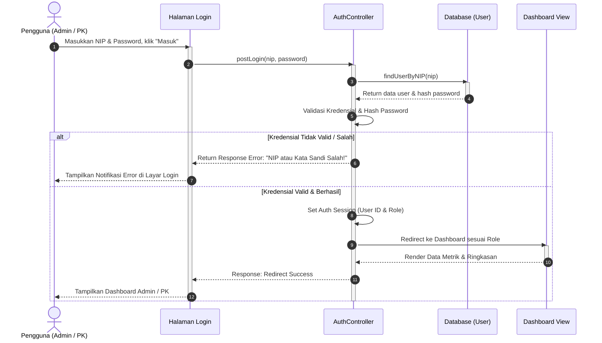
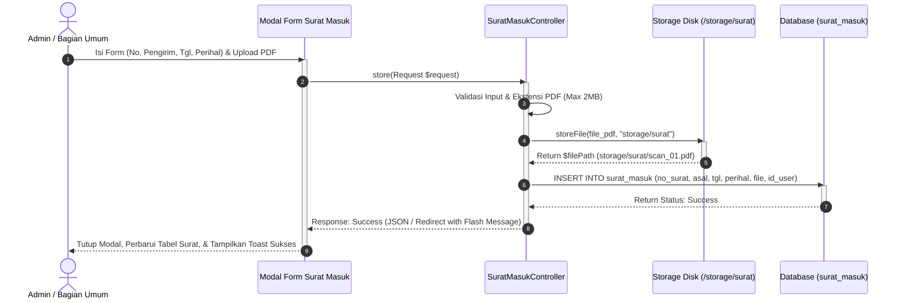
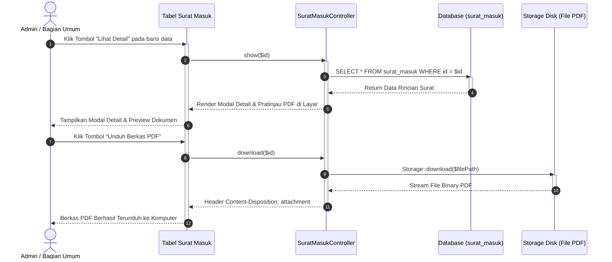
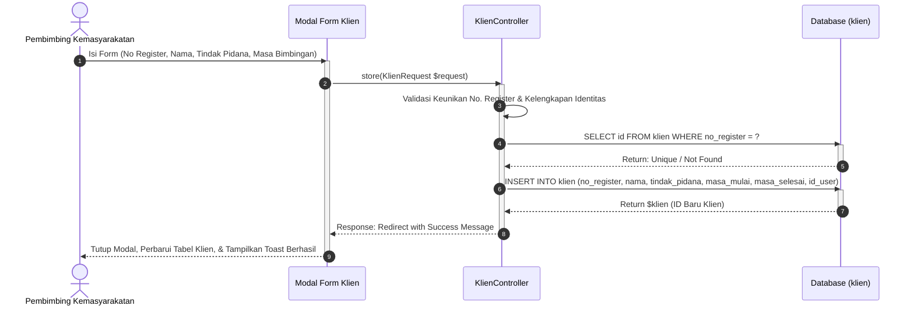
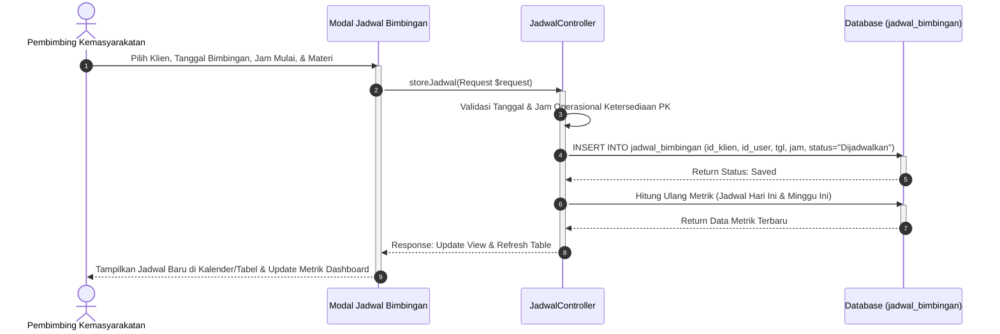
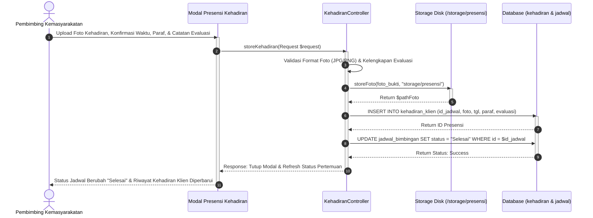

# Spesifikasi & Sequence Diagram Lengkap - Sistem Informasi SIMBA
**Balai Pemasyarakatan (Bapas) Kelas I Banjarmasin**

> [!TIP]
> File diagram siap buka & edit untuk **Draw.io / diagrams.net** tersedia di folder `diagram/`:
> - [`c:\laragon\www\SIMBA\diagram\sequence_diagram_simba.drawio`](file:///c:/laragon/www/SIMBA/diagram/sequence_diagram_simba.drawio)
> 
> *Struktur 6 Tab Sheet Lengkap di Draw.io:*
> 1. `1. Sequence Login Sistem`: Alur autentikasi login pengguna (NIP & Password), pengecekan hash password, penanganan salah, hingga pengalihan ke dashboard sesuai role.
> 2. `2. Sequence Tambah Surat Masuk`: Alur input data surat masuk, validasi file scan PDF, penyimpanan ke *storage*, dan perekaman ke database MySQL.
> 3. `3. Sequence Detail & Unduh Surat`: Alur pengambilan data spesifik surat dari database, pratinjau PDF di browser, dan pengunduhan berkas PDF.
> 4. `4. Sequence Tambah Data Klien`: Alur registrasi klien bapas baru, validasi keunikan nomor register, relasi ke PK pendamping, dan pembaruan tabel.
> 5. `5. Sequence Penjadwalan Bimbingan`: Alur pembuatan jadwal pertemuan tatap muka, validasi waktu operasional, dan pembaruan otomatis kartu metrik dashboard PK.
> 6. `6. Sequence Bukti Kehadiran Klien`: Alur pengunggahan foto bukti kehadiran fisik, paraf verifikasi, catatan evaluasi, dan otomasi update status jadwal bimbingan menjadi "Selesai".

---

## 1. Sequence Diagram: Autentikasi / Login Sistem (Multi-Role)
Menggambarkan interaksi antara **Pengguna (Admin/PK)**, **Halaman Login (View)**, **AuthController (Controller)**, **Database MySQL (Model User)**, dan **Dashboard View**.

---

## 2. Sequence Diagram: Pengelolaan Surat Masuk - Tambah & Upload PDF (Admin)
Menggambarkan proses pencatatan surat masuk kedinasan, penanganan upload file PDF ke *storage*, dan perekaman metadata ke basis data.

---

## 3. Sequence Diagram: Lihat Detail & Unduh Berkas Surat (Admin)
Menggambarkan proses melihat rincian surat, pratinjau berkas digital secara *inline*, serta proses pengunduhan (*download*) dokumen fisik dari penyimpanan server.

---

## 4. Sequence Diagram: Pendaftaran Master Klien Pemasyarakatan (PK)
Menggambarkan alur pendaftaran klien pemasyarakatan baru di Bapas, validasi keunikan nomor registrasi perkara, dan relasi langsung ke akun PK pembimbing terkait.

---

## 5. Sequence Diagram: Penjadwalan Bimbingan Klien (PK)
Menggambarkan alur penetapan jadwal pertemuan bimbingan tatap muka antara PK dan klien bapas, penentuan materi bimbingan, serta pembaruan otomatis pada metrik *Dashboard PK* (Jadwal Hari Ini & Jadwal Minggu Ini).

---

## 6. Sequence Diagram: Pencatatan Bukti Kehadiran Klien / Wajib Lapor (PK)
Menggambarkan proses presensi tatap muka wajib lapor klien di Bapas: pengunggahan foto fisik kehadiran, perekaman paraf verifikasi, pencatatan evaluasi perkembangan kepribadian/kemandirian, hingga otomatisasi pengubahan status jadwal menjadi **"Selesai"**.

