# Spesifikasi & Sequence Diagram Lengkap - Sistem Informasi SIMBA
**Balai Pemasyarakatan (Bapas) Kelas I Banjarmasin**

> [!TIP]
> File diagram siap buka & edit untuk **Draw.io / diagrams.net** tersedia di folder `diagram/`:
> - [`c:\laragon\www\SIMBA\diagram\sequence_diagram_simba.drawio`](file:///c:/laragon/www/SIMBA/diagram/sequence_diagram_simba.drawio)
> 
> *Struktur 12 Tab Sheet Lengkap di Draw.io:*
> 1. `1. Sequence Login Sistem`: Alur autentikasi login pengguna (NIP & Password), pengecekan hash password, penanganan salah, hingga pengalihan ke dashboard sesuai role.
> 2. `2. Sequence Tambah Surat Masuk`: Alur input data surat masuk, validasi file scan PDF, penyimpanan ke *storage*, dan perekaman ke database MySQL.
> 3. `3. Sequence Detail & Unduh Surat`: Alur pengambilan data spesifik surat dari database, pratinjau PDF di browser, dan pengunduhan berkas PDF.
> 4. `4. Sequence Tambah Data Klien`: Alur registrasi klien bapas baru, validasi keunikan nomor register, relasi ke PK pendamping, dan pembaruan tabel.
> 5. `5. Sequence Penjadwalan Bimbingan`: Alur pembuatan jadwal pertemuan tatap muka, validasi waktu operasional, dan pembaruan otomatis kartu metrik dashboard PK.
> 6. `6. Sequence Bukti Kehadiran Klien`: Alur pengunggahan foto bukti kehadiran fisik, paraf verifikasi, catatan evaluasi, dan otomasi update status jadwal bimbingan menjadi "Selesai".
> 7. `7. Sequence Tambah Surat Keluar (Create)`: Alur pencatatan surat dinas keluar baru, validasi berkas PDF, upload ke server storage `/storage/surat_keluar/`, dan simpan ke database.
> 8. `8. Sequence Detail & Unduh Surat Keluar (Read)`: Alur pengambilan detail surat keluar, penayangan pratinjau PDF di modal, serta streaming unduh file PDF.
> 9. `9. Sequence Edit Surat Keluar (Update)`: Alur pengubahan rincian surat keluar, penggantian berkas PDF baru (opsional dengan auto-delete berkas lama di server), dan pembaruan record di DB.
> 10. `10. Sequence Hapus Surat Keluar (Delete)`: Alur konfirmasi penghapusan surat keluar, pembersihan berkas fisik PDF dari storage disk, serta penghapusan record di DB.
> 11. `11. Sequence Hapus Surat Masuk (Delete)`: Alur dialog konfirmasi, penghapusan file scan PDF dari storage `/storage/surat/`, dan penghapusan data surat masuk di DB.
> 12. `12. Sequence Hapus Data Klien (Delete)`: Alur penghapusan data klien beserta riwayat relasi bimbingan di DB, serta pengurangan otomatis kartu metrik Total Klien pada Dashboard PK.

---

## 1. Sequence Diagram: Autentikasi / Login Sistem (Multi-Role)
Menggambarkan interaksi antara **Pengguna (Admin/PK)**, **Halaman Login (View)**, **AuthController (Controller)**, **Database MySQL (Model User)**, dan **Dashboard View**.

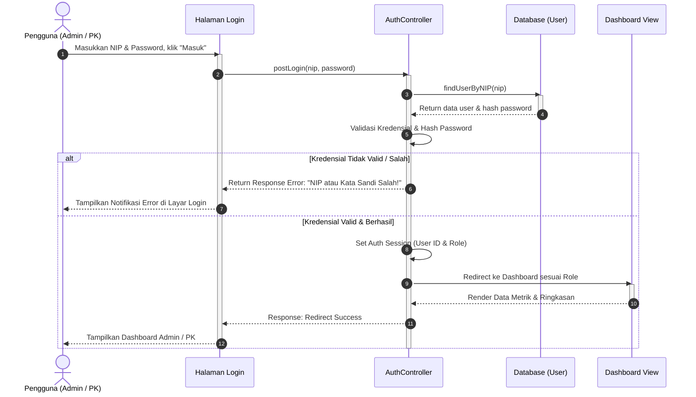

---

## 2. Sequence Diagram: Tambah Surat Masuk (Admin / Bagian Umum)
Menggambarkan proses pencatatan surat masuk kedinasan, penanganan upload file PDF ke *storage*, dan perekaman metadata ke basis data.

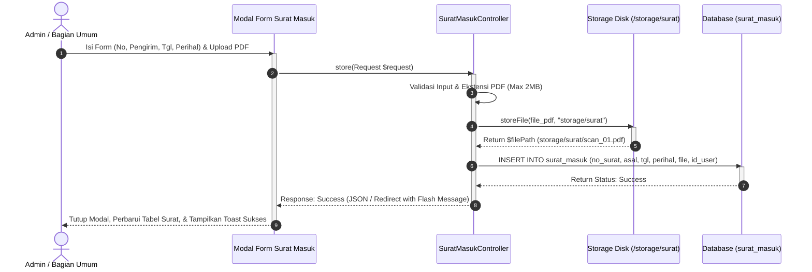

---

## 3. Sequence Diagram: Lihat Detail & Unduh Berkas Surat Masuk (Admin)
Menggambarkan proses melihat rincian surat masuk, pratinjau berkas digital secara *inline*, serta proses pengunduhan (*download*) dokumen fisik dari penyimpanan server.

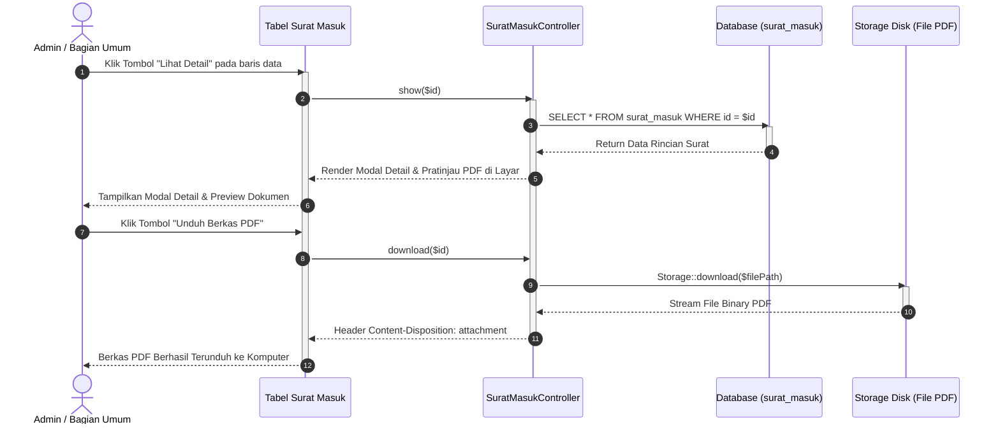

---

## 4. Sequence Diagram: Tambah Surat Keluar & Upload PDF / Create (Admin)
Menggambarkan proses pencatatan naskah dinas keluar Bapas ke instansi luar, validasi berkas scan digital PDF, penyimpanan berkas ke storage `/storage/surat_keluar/`, dan perekaman record ke database.

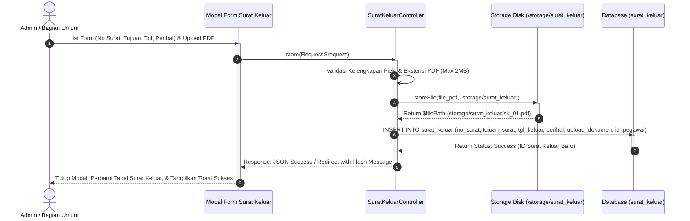

---

## 5. Sequence Diagram: Lihat Detail & Unduh Surat Keluar / Read (Admin)
Menggambarkan proses peninjauan arsip surat keluar Bapas, pratinjau dokumen PDF langsung di browser, serta proses pengunduhan (*download*) salinan berkas fisik.

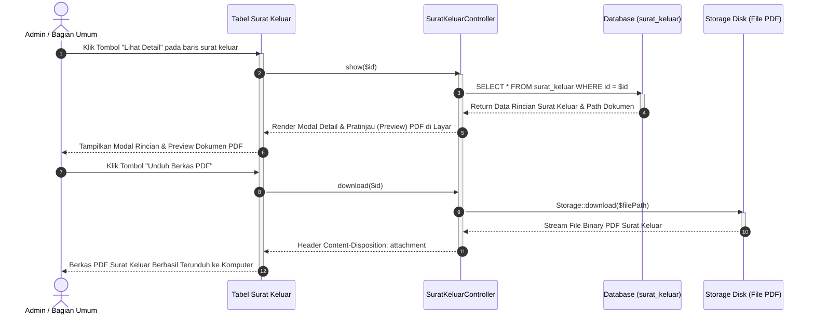

---

## 6. Sequence Diagram: Edit / Update Surat Keluar (Admin)
Menggambarkan proses pembaruan data naskah dinas keluar, penanganan opsional penggantian file PDF baru (menghapus file lama di storage dan menyimpan file baru), serta pembaruan record di basis data.

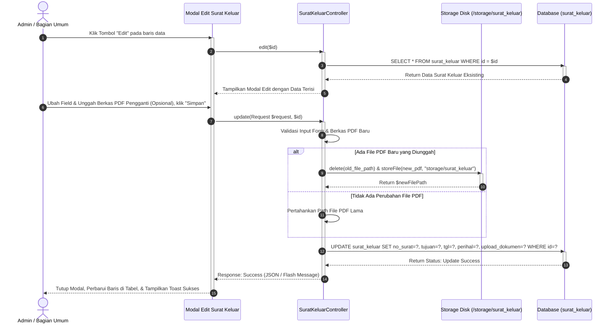

---

## 7. Sequence Diagram: Hapus Surat Keluar / Delete (Admin)
Menggambarkan alur penghapusan arsip surat dinas keluar: dialog konfirmasi pengamanan data, pembersihan berkas scan digital PDF dari server storage, dan penghapusan record dari database.

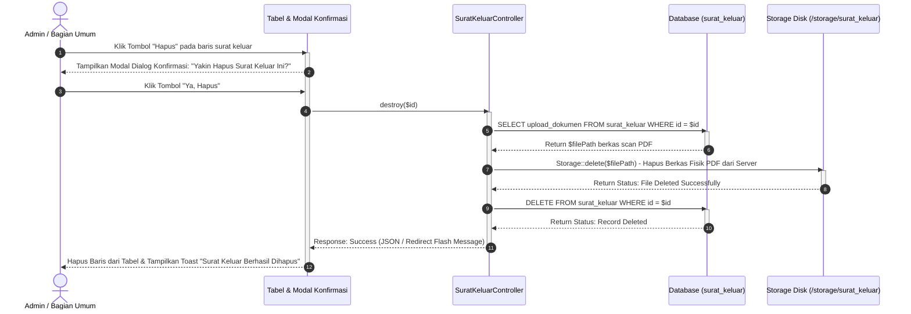

---

## 8. Sequence Diagram: Hapus Surat Masuk / Delete (Admin)
Menggambarkan alur penghapusan surat masuk kedinasan, penghapusan file scan PDF dari folder `/storage/surat/`, dan penghapusan data di basis data MySQL.

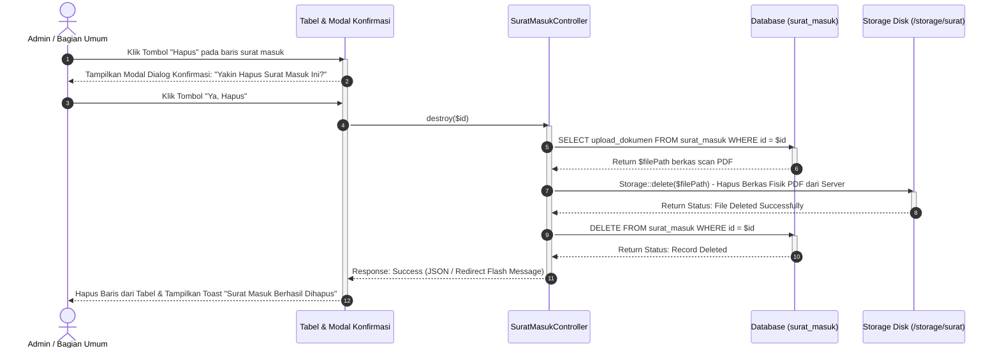

---

## 9. Sequence Diagram: Pendaftaran Master Klien Pemasyarakatan (PK)
Menggambarkan alur pendaftaran klien pemasyarakatan baru di Bapas, validasi keunikan nomor registrasi perkara, relasi langsung ke akun PK pembimbing, dan pembaruan kartu metrik *Total Klien* (+1).

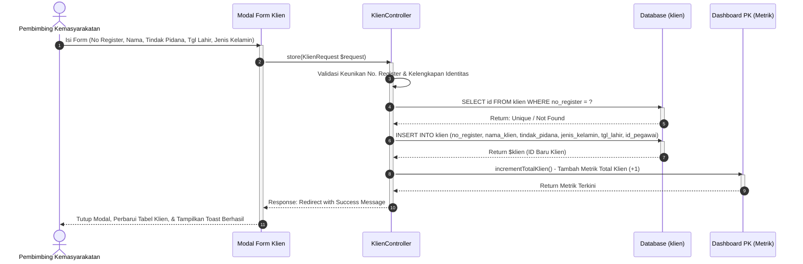

---

## 10. Sequence Diagram: Hapus Data Klien Pemasyarakatan / Delete (PK)
Menggambarkan alur penghapusan master klien pemasyarakatan: dialog proteksi konfirmasi, pembersihan riwayat relasi bimbingan dan presensi di database, serta pembaruan otomatis pengurangan nilai metrik *Total Klien* (-1) pada Dashboard PK.

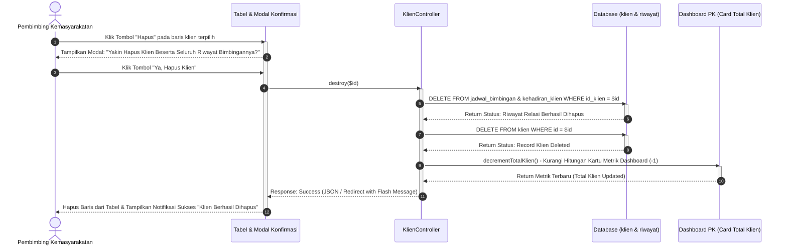

---

## 11. Sequence Diagram: Penjadwalan Bimbingan Klien (PK)
Menggambarkan alur penetapan jadwal pertemuan bimbingan tatap muka antara PK dan klien bapas, penentuan materi bimbingan, pengecekan bentrok jadwal, serta pembaruan otomatis pada metrik *Dashboard PK* (Jadwal Hari Ini & Jadwal Minggu Ini).

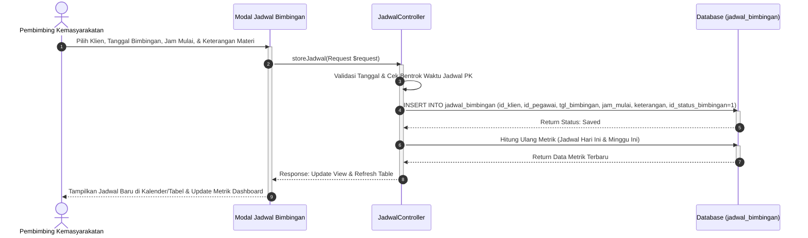

---

## 12. Sequence Diagram: Pencatatan Bukti Kehadiran Klien / Wajib Lapor (PK)
Menggambarkan proses presensi tatap muka wajib lapor klien di Bapas: pengunggahan foto fisik kehadiran, pencatatan evaluasi pembimbingan, penyimpanan foto ke `/storage/presensi/`, hingga otomatisasi pengubahan status jadwal menjadi **"Selesai"**.

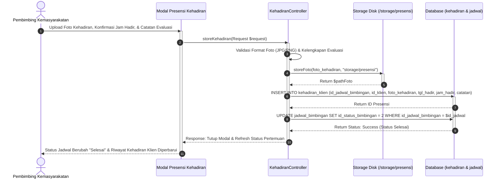
