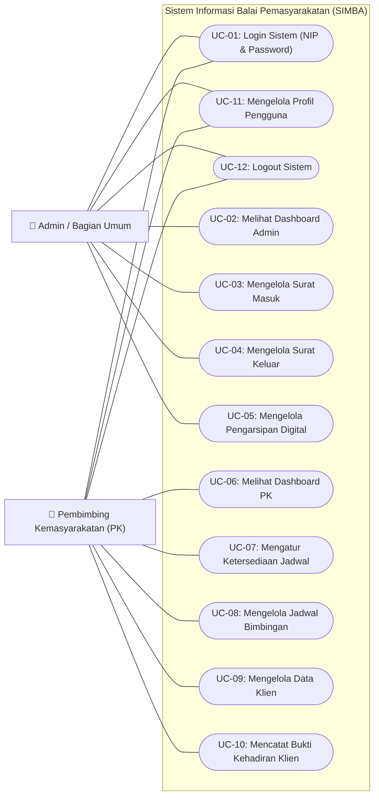

# Spesifikasi & Use Case Diagram - Sistem Informasi SIMBA
**Balai Pemasyarakatan (Bapas) Kelas I Banjarmasin**

> [!TIP]
> File visual siap edit untuk **Draw.io / diagrams.net** tersedia di:
> - [`c:\laragon\www\SIMBA\diagram\use_case_simba.drawio`](file:///c:/laragon/www/SIMBA/diagram/use_case_simba.drawio)
> 
> Anda dapat membukanya melalui web di [app.diagrams.net](https://app.diagrams.net/) atau menggunakan ekstensi **Draw.io Integration** di Visual Studio Code.

---

## 📌 Ringkasan Sistem & Batasan Aktor
Sistem Informasi SIMBA dikembangkan untuk mendigitalisasi proses administrasi di Balai Pemasyarakatan (Bapas) Kelas I Banjarmasin dengan melibatkan 2 (dua) aktor utama:
1. **Admin / Bagian Umum**: Bertanggung jawab atas pengelolaan surat masuk, surat keluar, dan pengarsipan digital dokumen dinas.
2. **Pembimbing Kemasyarakatan (PK)**: Bertanggung jawab atas pengelolaan data klien pemasyarakatan, penjadwalan bimbingan, ketersediaan jadwal, dan pencatatan bukti kehadiran/wajib lapor klien.

---

## 📊 Use Case Diagram (Notasi UML)

---

## 👥 Definisi Aktor

| Aktor | Peran & Tanggung Jawab dalam Sistem |
| :--- | :--- |
| **Admin / Bagian Umum** | Petugas staf tata usaha/bagian umum yang mengelola seluruh administrasi persuratan dinas (surat masuk dan surat keluar), mengunggah berkas scan digital, mengunduh arsip, serta memantau ringkasan statistik persuratan pada dashboard. |
| **Pembimbing Kemasyarakatan (PK)** | Pejabat fungsional yang bertugas mendampingi dan membimbing klien pemasyarakatan, mengelola master data klien, mengatur ketersediaan hari dan jam bimbingan, menjadwalkan sesi bimbingan, memverifikasi presensi fisik, serta mencatat bukti kehadiran dan evaluasi perkembangan klien. |

---

## 📋 Deskripsi Rinci Setiap Use Case

### 1. Modul Autentikasi & Akun
- **UC-01: Login Sistem**
  - **Aktor:** Admin / Bagian Umum, Pembimbing Kemasyarakatan (PK).
  - **Deskripsi:** Pengguna masuk ke sistem menggunakan kredensial berupa **NIP (sebagai username)** dan kata sandi (*password*). Sistem akan mengidentifikasi role pengguna dan mengarahkannya ke dashboard yang sesuai (*role-based redirect*).
- **UC-11: Mengelola Profil Pengguna**
  - **Aktor:** Admin / Bagian Umum, Pembimbing Kemasyarakatan (PK).
  - **Deskripsi:** Pengguna melihat informasi data diri akun masing-masing.
  - *Aturan Bisnis:* Tidak ada fitur ubah kata sandi (*Change Password*) mandiri baik untuk Admin maupun PK. Pada profil PK, data kontak ditiadakan.
- **UC-12: Logout Sistem**
  - **Aktor:** Admin / Bagian Umum, Pembimbing Kemasyarakatan (PK).
  - **Deskripsi:** Mengakhiri sesi pengguna saat ini dan menghapus token autentikasi.

### 2. Modul Admin / Bagian Umum
- **UC-02: Melihat Dashboard Admin**
  - **Aktor:** Admin / Bagian Umum.
  - **Deskripsi:** Menampilkan metrik statistik berupa total surat masuk, total surat keluar, dan total dokumen digital terarsip, serta tabel aktivitas terkini.
- **UC-03: Mengelola Surat Masuk**
  - **Aktor:** Admin / Bagian Umum.
  - **Deskripsi:** Melakukan operasi CRUD (Tambah data surat, melihat detail informasi, mengubah data, dan menghapus data) serta mengunggah file berkas digital scan surat (PDF).
- **UC-04: Mengelola Surat Keluar**
  - **Aktor:** Admin / Bagian Umum.
  - **Deskripsi:** Melakukan operasi CRUD untuk surat keluar dinas Bapas beserta pengunggahan lampiran berkas digital.
- **UC-05: Mengelola Pengarsipan Digital**
  - **Aktor:** Admin / Bagian Umum.
  - **Deskripsi:** Pencarian terpusat berkas digital surat masuk dan keluar, pratinjau dokumen, dan pengunduhan berkas lampiran.

### 3. Modul Pembimbing Kemasyarakatan (PK)
- **UC-06: Melihat Dashboard PK**
  - **Aktor:** Pembimbing Kemasyarakatan (PK).
  - **Deskripsi:** Menampilkan **3 kartu metrik statistik utama**:
    1. **Jadwal Hari Ini**
    2. **Jadwal Minggu Ini**
    3. **Total Klien**
    Serta tabel daftar jadwal bimbingan terdekat.
- **UC-07: Mengatur Ketersediaan Jadwal**
  - **Aktor:** Pembimbing Kemasyarakatan (PK).
  - **Deskripsi:** Menentukan preferensi waktu layanan bimbingan oleh PK.
  - *Aturan Bisnis:* Cukup menentukan **Hari** dan **Jam Mulai** bimbingan (tanpa batasan jam selesai dan tanpa batasan kuota harian klien).
- **UC-08: Mengelola Jadwal Bimbingan**
  - **Aktor:** Pembimbing Kemasyarakatan (PK).
  - **Deskripsi:** Menjadwalkan sesi pertemuan bimbingan tatap muka dengan klien, menentukan tanggal, jam mulai, catatan materi, dan mengubah status jadwal.
- **UC-09: Mengelola Data Klien**
  - **Aktor:** Pembimbing Kemasyarakatan (PK).
  - **Deskripsi:** Melakukan pengelolaan data master klien pemasyarakatan (No. Register, Nama Klien, Kasus/Tindak Pidana, Masa Bimbingan, Status Klien).
  - *Aturan Bisnis:* **Tidak ada field/kolom Jenis Bimbingan** pada modul data klien.
- **UC-10: Mencatat Bukti Kehadiran Klien**
  - **Aktor:** Pembimbing Kemasyarakatan (PK).
  - **Deskripsi:** Mencatat pelaksanaan wajib lapor/kehadiran bimbingan fisik klien, mengunggah foto bukti fisik kehadiran, mengisi waktu kehadiran, paraf verifikasi, dan mencatat hasil evaluasi perkembangan kepribadian/kemandirian klien.

---

## 🔒 Matriks Hak Akses Use Case (Access Matrix)

| Kode UC | Nama Use Case | Admin / Bagian Umum | Pembimbing Kemasyarakatan (PK) |
| :---: | :--- | :---: | :---: |
| **UC-01** | Login Sistem (NIP & Password) | ✅ | ✅ |
| **UC-02** | Melihat Dashboard Admin | ✅ | ❌ |
| **UC-03** | Mengelola Surat Masuk | ✅ | ❌ |
| **UC-04** | Mengelola Surat Keluar | ✅ | ❌ |
| **UC-05** | Mengelola Pengarsipan Digital | ✅ | ❌ |
| **UC-06** | Melihat Dashboard PK (3 Metrik) | ❌ | ✅ |
| **UC-07** | Mengatur Ketersediaan Jadwal | ❌ | ✅ |
| **UC-08** | Mengelola Jadwal Bimbingan | ❌ | ✅ |
| **UC-09** | Mengelola Data Klien | ❌ | ✅ |
| **UC-10** | Mencatat Bukti Kehadiran Klien | ❌ | ✅ |
| **UC-11** | Mengelola Profil Pengguna | ✅ | ✅ |
| **UC-12** | Logout Sistem | ✅ | ✅ |
